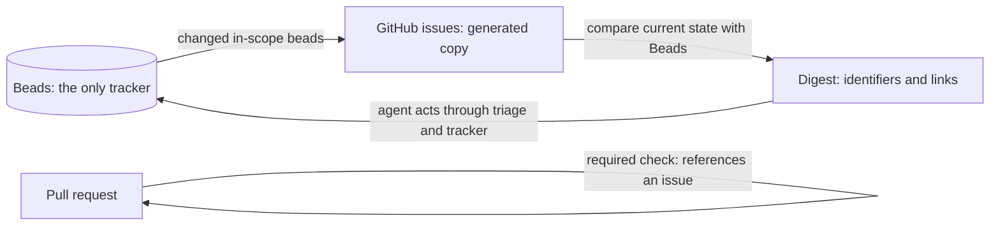

# Beads → GitHub mirror

Status: approved (revision 5), by the owner on 2026-11-20
Approved by: direction approved by the owner in conversation on 2026-11-20: a one-way mirror; an
own script now, moving to Beads' built-in sync later; the default mirror scope; a hard pull-request
check; incremental runs with a scheduled full comparison; packaging and triggers; the close reason
posted as a closing comment; (revision 3) a report-only inbound side; and (revision 5) seven
simplifications from an independent review. Revision 5 answers that review
(`scratchpad/mvp-stack/mirror/critic-mirror-spec-fable.md`) and the fourth critic round
(`critic-mirror-spec-r4.md`; earlier rounds beside them), and its last changes answer the final,
blockers-only round (`critic-mirror-spec-r5.md`). The owner approved it on 2026-11-20; the critic
reports are local working files, not committed.

## Problem Statement

Beads is the owner's tracker in every project, but collaborators, outside contributors and
ecosystem tools only see GitHub issues and pull requests. Today a project's work is invisible on
GitHub, and a pull request from someone else is linked to no bead, so its merge never reaches the
tracker. The owner wants GitHub to show the work without keeping two trackers: nothing tracked
twice, nothing edited in two places.

## Solution

Beads stays the only tracker. A project that opts in gets a generated copy of its public-facing
beads as GitHub issues, written by one designated clone. The mirror never changes Beads on its own
apart from recording the link to an issue it created: what happens on GitHub (a merged pull request,
a new outside issue, a hand-closed issue) is reported in a digest, and agents act on it through the
skills that already own those decisions. Every pull request must reference an issue, enforced by a
required check the pull request cannot change; the digest checks that the reference is real and
tracked, before and after the merge.

## User Stories

1. As the owner, I want my public-facing beads to appear as GitHub issues, so that collaborators see
   the work without my maintaining a second tracker.
2. As the owner, I want Beads to stay the single place work is edited, and the mirror never to
   decide anything in Beads by itself, so that the tracker only changes through the rules it
   already has.
3. As the owner, I want publishing to need an explicit switch in one clone, bound to the Beads
   store, the destination and the scope I approved, so that nothing else can start or widen writing
   to GitHub.
4. As the owner, I want to keep any single bead off GitHub, and private material in a bead's text
   held rather than published, so that opting a project in never publishes something by accident.
5. As a collaborator, I want each mirrored issue to say it is generated and that its text follows
   the bead, so that I comment instead of editing. An edit to the text on GitHub is replaced by the
   bead's version (GitHub keeps the edit history); an open-or-closed change made on GitHub is
   reported and left in place until the owner decides.
6. As an outside contributor, I want to open an issue and reference it from my pull request with
   `Closes #N` or `Refs #N`, so that I use the conventions I already know.
7. As the owner, I want every pull request to fail a required check unless it references an issue,
   and the digest to show any open or merged pull request whose reference is missing, not an issue,
   or has no bead, so that every merged change can be traced to a bead.
8. As an agent starting a session, I want a short, current digest of what differs between GitHub and
   Beads, with identifiers and links only, so that I can act without waiting on the network and
   without reading text an outsider wrote as if it were an instruction.
9. As an agent, I want the digest to tell me when an issue was closed by a merged pull request while
   its bead is still open, with the pull request, merge commit and merger, so that I can close the
   bead with evidence when its acceptance, reviews and owner decisions allow.
10. As the owner, I want a run never to create a second issue for a bead, even after a crash or a
    lost state file, and a failed create to need my attention only when no evidence can settle it,
    so that GitHub never shows
    duplicates and the mirror does not generate chores.
11. As the owner, I want each run to read and write only what changed, and a weekly full comparison
    to catch anything missed, so that runs stay cheap and a miss only delays a report.
12. As the owner, I want a project that has not opted in to be untouched, so that installing the
    harness never writes to GitHub by surprise.

## Implementation Decisions

### Project states

| State | How it is recognised | Hook | `pr` and `tracker` |
|---|---|---|---|
| Not opted in | No check workflow committed and no switch in this clone | Prints nothing | Behave as today; no mirror step |
| Opted in, not the writer | The check workflow is committed; no switch here | Prints nothing | `pr` references an issue already linked to the bead or an ancestor; with none, it stops with "ask the writer clone to mirror this bead". `tracker` skips outbound with one line saying so |
| Writer clone | The switch is present | Prints the digest summary, starts the background run | As below |

Links recorded in the writer clone reach other clones through the ordinary Beads sync or the
committed `.beads/issues.jsonl`, under the Beads rules' authority.

### Authority and activation

- **The writer switch.** A local, never-committed file in the clone's common git directory, under
  `bead-mirror/`, so its linked worktrees share it. It holds: the GitHub host; the repository's
  permanent node ID and name; the GitHub account the mirror writes as (the *mirror account*); the
  scope, a list of bead types eligible for creation (default `epic, feature, bug`); whether `pr` may
  enrol a bead outside that list (default yes); and the identity of the Beads store it publishes
  from (the store's `project_id`). The owner creates and edits it.
- **Checks before any write.** The Beads store, resolved explicitly from the switch (environment
  overrides ignored), has the recorded identity; the `gh` login is the mirror account; the repository
  at the recorded name has the recorded node ID. Every GitHub call names the switch's host and
  repository explicitly, so an ambient default cannot redirect it, and every write is a GraphQL
  mutation addressed by node ID (the repository's for a create, the issue's for an edit, close or
  comment), so a renamed repository whose old name is reused never receives a write. The state file records the same
  store identity, node ID and mirror account; any mismatch stops the run with a report and no writes
  until the owner runs `reset-state`, which discards the state so the next run rebuilds it by the
  lost-state rules.
- **One writer, one lock.** Only the clone holding the switch writes. Every entry point that changes
  state (outbound, overwrite, retire, dismiss, the `pr` path, the background worker) takes one
  clone-wide lock in the process that writes and holds it until its state is durably written. The
  `pr` path waits for the lock up to a bound, then reports busy.
- **Where it runs.** State, digest, lock and log live beside the switch. A skill-triggered run that
  cannot write there or reach the network (a sandboxed agent) reports that and leaves the work to the
  next background run.
- **Beads writes.** The mirror's only Beads write is recording the URL of an issue it created in that
  bead's `external_ref`, as actor `bead-mirror:<clone id>`. Beads has no write-if-unchanged, so link
  writes are serialised instead: in the writer clone, `triage` records a tracking-only link through
  the command's `link` subcommand, which takes the same lock, checks the issue and writes the field
  as the calling agent's actor. Under the lock, either writer writes only if the field is empty;
  the same URL already present counts as success, a different one is a conflict that leaves the
  field as it is and is reported. Beads auto-exports, so this changes the tracked
  `.beads/issues.jsonl`; committing it follows the Beads session-close rule.

### Scope, enrolment and links

- **Eligibility to be created.** A bead whose type is in the switch's scope, with status `open`,
  `in_progress`, `review` or `blocked` (never `deferred`), and without the exclusion; or a bead the
  `pr` skill asks to mirror, when the switch allows it. A bead closed before its first successful
  publish is never created. Beads are read with `bd export` (or `bd list --all -n 0`), never
  `bd show`.
- **Exclusion.** Bead metadata `mirror=never` (`bd update <id> --set-metadata mirror=never`) keeps a
  bead off GitHub; create and `pr` honour it. Set on an enrolled bead, it retires the bead's issue.
- **Creation is foreground only.** The background run updates and closes but never creates; issues
  are created by `tracker`, `pr` or a manual run, so a first publication always follows an agent's or
  the owner's action. The digest counts eligible beads not yet published.
- **Private-material screen.** Title, description, acceptance and close reason pass a screen for
  private material (local paths, internal hostnames, anything the plugin's existing leak check
  flags). A failing title or body holds that write and is reported; a failing close reason is
  replaced with "Closed in Beads" and reported. The screen is best-effort, not an approval of what is
  public.
- **Mentions.** `@name` and `#N` in generated text are wrapped in code spans, so publishing notifies
  no one and cross-links nothing.
- **Enrolment.** A bead is *enrolled* when the mirror created or adopted its issue (recorded in the
  state and proved by the issue being authored by the mirror account with the bead's banner).
  Enrolment, not the scope, decides continuing management: an enrolled bead stays managed when it
  closes, reopens or changes type.
- **Retire.** The owner's retire subcommand, or the exclusion, stops managing an issue and leaves it
  open or closed as it is, with one last write: its banner's machine-readable line is marked retired.
  Retirement therefore lives on GitHub, survives a lost or reset state, and a retired issue is never
  managed or adopted again; from then on it is tracking-only. If that write fails, retirement fails
  and is reported. A bead missing from Beads is reported, never retired automatically.
- **Tracking-only links.** An outside issue that `triage` links to a bead (through the `link`
  subcommand in the writer clone, or the ordinary Beads workflow elsewhere), and a retired issue, are
  tracking-only: the mirror never edits them and never creates a second issue for that bead. The
  digest still reports their state.
- **Link checks.** A link counts only if it names an issue (not a pull request) in the switch's
  repository. A bead whose `external_ref` names another tracker or repository is skipped. Two beads
  naming the same issue are reported and both left alone.

### Outbound (Beads → GitHub), enrolled beads only

- **What each run touches.** Beads changed in Beads since the outbound checkpoint, enrolled issues
  GitHub reports as updated since the inbound checkpoint (so a text edit on GitHub is repaired on the
  next run), and held states. The full comparison covers the rest weekly.
- **Components.** Title; body; the `bead-type:` label; open or closed; the closing comment.
- **Body.** The banner (a visible sentence that the issue is generated from the bead and that its
  text follows the bead, so comment instead of editing; plus a machine-readable line naming the
  Beads store's identity and the bead, and marking a retired issue)
  at the top, then description and acceptance, within a 60,000-character budget that reserves room
  for the banner and a truncation note.
- **Text converges.** Title, body and the type label follow the bead: when the canonical form of what
  GitHub shows differs from the canonical form Beads wants, the mirror writes Beads' value. Canonical
  forms: titles trimmed; bodies with line endings normalised and trailing whitespace removed; label
  names compared without case. Only labels named `bead-type:…` are touched, one at a time.
- **Not storable.** When the read-back after the mirror's own write still differs canonically from
  what was sent, the component is marked not storable for that desired value, reported, and not
  rewritten until the bead changes.
- **Open or closed is held, not overwritten.** The state keeps the value last confirmed by a
  read-back (*confirmed*, or unknown):

  | Observed compared with desired and confirmed | Action |
  |---|---|
  | observed = desired | In agreement: record it as confirmed, clear any hold |
  | observed = confirmed ≠ desired | Beads changed: write desired, read back; record confirmed only if the read-back equals the value sent, otherwise hold and report |
  | observed ≠ confirmed, observed ≠ desired | Changed on GitHub: hold, report, no write |
  | confirmed unknown, observed ≠ desired | Cannot tell who changed it: hold, report, no write |

  A hold is resolved by updating the bead to agree, or by the overwrite subcommand, with the owner's
  authorization, which reads fresh and writes desired.
- **Create, never twice.** Before creating, the writer lists every issue, open and closed, authored by
  the mirror account (the issues listing filtered by creator, not search) and reads each banner
  locally; if the listing is incomplete, nothing is created this run. A banner counts only when its
  store identity matches the switch's. Exactly one non-retired issue whose banner names this store and
  bead: adopt it and link it. Several, or a mirror-authored issue naming the bead with a missing or
  different store identity: hold creation for that bead and report it. None: create.
  Before sending a create, the writer durably records a pending attempt for the bead; it records the
  returned number at once, and clears the attempt on adoption or on an error response received
  before GitHub created anything. While an attempt is pending and the listing shows no match, the
  bead is not created again: the run rechecks on later runs, and after a day with no match it holds
  creation and reports it, for the owner's `resolve` subcommand. In practice a lost response is
  adopted on the next run; the hold remains for the case no evidence can settle. An issue not
  authored by the mirror account is never adopted.
- **Close.** When an enrolled bead closes, the open-or-closed state is written by the table above.
  Only after the close is confirmed is the closing comment posted. Its key is the bead ID, the close
  time Beads recorded and a hash of the close reason; only a comment authored by the mirror account
  carrying that key counts as posted. Before posting, the writer reads all of the issue's comments;
  if the read is incomplete, it posts nothing and retries next run. A reopen and second close with a
  different time or reason gets a new key, so one more comment.

### Inbound (GitHub → digest)

The inbound side writes nothing to Beads or GitHub. It compares GitHub's current state with Beads and
lists the differences. "Since opt-in" means after the writer's first run, recorded in the state.

| Difference | Digest entry | Who acts, and how |
|---|---|---|
| A linked issue is closed and its bead is open | When GitHub's closing event names a merged pull request: that pull request, its merge commit and merger. When it names none: "closed on GitHub, no pull request". When it cannot be read or attributed: "closed on GitHub, cause unknown" | An agent through `tracker`: closes the bead with that evidence when its acceptance, reviews and owner decisions allow, or comments and leaves it open |
| An enrolled issue reopened on GitHub while its bead is closed | The issue | The owner: reopen the bead, or overwrite |
| A tracking-only issue still open while its bead is closed | The issue and bead | `triage`, with the owner's authorization to comment or close on GitHub |
| A held, not-storable or screened component | The issue, the component and why | The owner: fix the bead, exclude it, or overwrite |
| An open issue no bead links to | The issue | `triage`: create a bead and link it (tracking-only), dismiss, or decline on GitHub with the owner's authorization |
| An issue no bead links to, closed since opt-in by a merged pull request | The issue and the pull request | `triage`: link it to a bead and close that with evidence, or dismiss |
| A pull request, open or merged since opt-in, whose references are missing, point at a pull request or a missing number, or point only at issues no bead links to | The pull request, each failing reference and why | `triage`, as above |
| An enrolled issue whose bead is missing from Beads; two beads naming one issue | The issue and bead IDs | The owner: retire, or fix the links |
| Eligible beads not yet published | A count | Run outbound in the foreground |

- **Dismiss.** A subcommand that records an issue or pull-request number as acknowledged, so its row
  clears; used by `triage` or the owner.
- **The reference grammar** is shared by the check and the digest, with one fixture table both test
  suites read. A reference is a keyword (`close`, `closes`, `closed`, `fix`, `fixes`, `fixed`,
  `resolve`, `resolves`, `resolved`, `ref`, `refs`; any case), an optional colon, whitespace, then
  `#` and a positive decimal number ending at a non-word character or the end of the text, or the
  full URL of an issue in this repository. `Refs #42abc` is not a reference. A pull request is
  tracked when at least one reference is a real issue that a bead links to; other references are
  listed but do not make it untracked.
- **Field allow-list.** Digest entries carry only issue and pull-request numbers, bead IDs, states,
  commit SHAs, GitHub logins (validated against GitHub's login character set, `[bot]` suffix
  allowed) and links. Titles, bodies and comments from GitHub never appear.
- **Keeping the digest current.** The state keeps the digest's open rows. Each run re-evaluates every
  open row, reads the issues and pull requests GitHub reports as updated since the previous run's
  start minus a few minutes, and re-checks the beads whose link or status changed in Beads since the
  Beads-side checkpoint (fetching both the old and the new issue when a link changed). The new
  digest and both checkpoints are written together in one atomic replacement of the state file when
  inbound ends; a run that cannot finish inbound writes none of them, and the previous digest stays,
  marked with its time.
- **Full comparison.** One pass over every issue and pull request, up to the highest number seen when
  the pass starts; newer items are covered by the incremental read. An interrupted pass restarts
  next run. Due when the last completed one is older than a week, at the next eligible run.

### Pull-request check

- **Contract.** The check establishes reference syntax only: the body contains at least one reference
  in the shared grammar. Whether the target is a real, tracked issue is the digest's job. The event
  only schedules the check: it reads the pull request's current body through the API at run time,
  never the body saved in the event payload, and never interpolates it into a script.
- **Trusted and minimal.** A GitHub Actions workflow triggered by `pull_request_target`, so it comes
  from the default branch, never from the pull request. It never checks out code; its only
  permission is reading pull requests. One job with a fixed name is the required check, required
  from GitHub Actions.
- **Triggers and freshness.** Opened, edited (which includes retargeting), reopened and synchronized,
  with a concurrency group per pull request that cancels older runs. Every run starts after the
  edit that triggered it and reads the current body, so once the last run finishes the result
  reflects the latest body, whatever order the events arrived in. Between an edit and that run's
  completion the earlier result still shows; this is a stated limit.
- **A same-name check cannot stand in.** Name-based protection matches a check by name and app, not
  by workflow, so a workflow added by a pull request could report a success under the same name.
  The supported setup therefore requires the owner's approval before workflows run for pull
  requests from outside contributors, so an added workflow does not run unseen; where the plan
  offers rulesets that require a specific workflow, the owner uses that instead. The digest still
  reports any merged pull request without a tracked reference.
- **Exempt authors** come from a repository variable, so the workflow file stays as shipped.
- **Fail closed.** No matching reference, an empty or unreadable body, or a malformed payload fails,
  with the fix in the message.
- **Supported setup.** Pull requests into the default branch, a branch protection rule or ruleset
  requiring the check, and an Actions policy that runs `pull_request_target` for the repository's
  pull requests, including forks, with approval required before workflows run for outside
  contributors' pull requests. A private repository needs a GitHub plan that allows required
  checks there; without one the check runs but cannot block. Not supported in this version: merge
  queues, direct pushes and roles allowed to bypass protection.

### Packaging

- **Residue shipped to every adopted project**, under the residue manifest's three-way update rule:
  the command, its hook launcher for each tool, and a session-start entry in `.claude/settings.json`
  and `.codex/hooks.json`. Without the switch they do nothing, which is what makes "not opted in"
  safe without a new installer option.
- **The command.** One single-file, standard-library-only command with subcommands for outbound,
  inbound (the digest), both, full comparison, link, overwrite, retire, resolve (a held create),
  dismiss, reset-state, install-check, the map (bead ↔ issue ↔ pull request) and the background
  supervisor.
- **The check's workflow** is not residue: the command's `install-check` subcommand writes it during
  activation, and committing it is what marks the project as opted in for every clone. The plugin's
  `doctor` reports when the committed workflow differs from the command's copy, and a stale, failing
  or held mirror.
- **Skill guidance** ships as ordinary skill text and follows the project states: `tracker` (acting on
  the digest; outbound after closing or seeding beads), `pr` (reference the bead's issue; for a bead
  with no issue, reference the nearest ancestor that has one, and only if none does, ask for the bead
  to be mirrored; write `Refs` unless the pull request completes the bead), `triage` (a new branch for
  untracked issues and pull requests, linking an outside issue as tracking-only through `link`,
  dismissing), and
  Babysit and Shipping once they exist (close the bead after reading a merge back).
- **Activation (owner-controlled), in order:** the live trial passes; set the exempt-authors variable;
  create the writer switch in one clone; dry run; first run (in the foreground) and read-back;
  `install-check` and commit the workflow; set the protection and Actions policy; then make the
  check required.
- In this repository it is built in the canonical harness first and reaches the plugin template at
  the end-of-project sync.

### Triggers: how an agent knows to run it

| Moment | Runs | Why |
|---|---|---|
| Session start or resume (a new hook entry beside the existing ones, in both tools) | In the writer clone: prints the latest digest's time, counts by row type, at most five rows and the path to the rest, read from a local file; then launches the background run if the last one started more than fifteen minutes ago | The agent sees the differences without the session waiting; the Beads context output is untouched |
| `pr`, before opening a pull request | Outbound for that bead when it has no issue and no ancestor has one, waiting for the lock and the link up to a bound | The body needs an issue number |
| `tracker`, after closing or seeding beads | Outbound, including creates | New and closed beads reach GitHub in the same session |
| Any time | Any subcommand, by a person or agent | Manual control |

The background run is inbound, then outbound without creates. The hook makes no network call and
returns at once. The supervisor outlives the hook: it starts with its input and output redirected to
a log file and runs the worker as a child in its own process group. The worker takes the lock itself
(or exits if it is held), checks its own deadline between calls, and releases the lock only when it
exits; the supervisor stops the whole group at a fixed deadline, reaps it and records the outcome.
If the supervisor dies, the worker still holds the lock and still stops at its own deadline.
Unfinished work waits for the next run. Rate limits are backed off.

### Constraints

Provider-neutral skill text; no machine paths; never uses the Beads commands the core rules forbid;
the forge command line is `gh`.

## Success Criteria

- **Outbound:** given a switch and an open feature bead, when `tracker` runs outbound, then one issue
  exists, authored by the mirror account, with the banner, title, description, acceptance and type
  label, and the bead's `external_ref` holds its URL; a second run makes no writes; the background
  run creates nothing.
- **Only the link:** after any run, nothing in the Beads store changed except `external_ref` on beads
  the mirror created or adopted an issue for.
- **Private:** a task, spike or decision bead, a deferred bead, a bead closed before opt-in, a bead
  with `mirror=never` (including through `pr`), and a `pr` enrolment the switch refuses are not
  published; a bead whose description holds a local path is held and reported; `@name` in a bead is
  published inside a code span.
- **Converge:** an issue title or body edited on GitHub is replaced by the bead's version on the next
  run; a label outside `bead-type:` is never touched; a value GitHub stores differently from what was
  sent is reported as not storable and not rewritten on later runs.
- **Close:** an enrolled bead closed in Beads closes its issue, then posts the screened close reason
  as one comment; a rerun adds none; a reopen and second close add one more, including within the
  same second with a different reason; a collaborator comment copying the key does not suppress it.
- **Open-or-closed held:** an issue closed or reopened on GitHub against the bead is held and
  reported on every run until the bead agrees or the owner overwrites; a collaborator change between
  the mirror's write and its read-back is held, not recorded as confirmed.
- **Merge reported:** given a linked bead and a merged pull request that closed its issue, the digest
  names the pull request, merge commit and merger, including when the pull request opened and merged
  between two runs; the bead stays open until an agent closes it.
- **Untracked:** an outside issue and a pull request referencing it appear in the digest; once
  `triage` links the issue to a bead, both rows clear on the next run even if nothing changed on
  GitHub; an outside issue closed by a merged pull request before anyone linked it, and a pull
  request merged with only `Refs` to a missing number, each appear until linked or dismissed.
- **Beads-side change:** an old closed outside issue newly linked to an open bead appears on the next
  run, without waiting for the full comparison.
- **References:** the fixture table gives the same answer in the check and the digest; one tracked
  reference among others makes a pull request tracked.
- **Check:** no reference fails with the fix in its message; a reference passes; an exempt author
  passes; a body edit re-runs it; two edits on the same head whose runs finish in reverse order end
  with the verdict for the latest body; a pull request that edits the workflow does not change its
  own verdict.
- **Create:** a run killed after GitHub created the issue but before recording it ends, next run,
  with exactly one linked issue, including when the issue was closed in between; a create whose
  response was lost while the listing lags creates no duplicate and is adopted once the listing
  shows it; a pending attempt with no match is never re-sent and holds after a day; an issue copying
  the banner but not authored by the mirror account is never adopted; several mirror-authored
  candidates, or one naming another store, hold creation and report it.
- **Store change:** after the switch moves to a second store with a bead of the same ID and the
  state is reset, the first store's issue is not adopted by the second store's bead.
- **Retire:** a retired issue is not managed or adopted again after the state file is deleted.
- **Link race:** a `link` from `triage` and the mirror's own link write for the same bead, in either
  order, leave the first link in place and report the second as a conflict.
- **Rename:** a repository renamed after the checks, with its old name taken by another repository,
  receives every write and the other repository none.
- **Lost state:** with the state file deleted, a run creates no issue for a bead that already has a
  mirror-authored issue, holds every open-or-closed state that differs from Beads, and reports them.
- **Authority:** no switch: no writes and no output. A different Beads store, a wrong `gh` account, a
  state file bound to another store or repository, or a repository with a different node ID: no
  writes and a report. An ambient repository override does not change where writes go.
- **Not opted in:** after `adopt` and `update` in a project with no switch and no workflow, a session
  start prints nothing, no mirror file is created, and `pr` and `tracker` behave as before.
- **Lock:** a manual run and the `pr` path started during a background run wait or report busy; with
  the supervisor killed mid-run, a manual run still waits until the worker exits.
- **Digest safety:** an issue whose title contains instruction-like text produces an entry with no
  title text; the session-start output stays within its cap.
- **Hook:** session start returns without waiting, the Beads context output is unchanged in both
  tools, and a slow worker and its child processes are stopped at the deadline with the outcome
  recorded.
- **Failures:** `gh` missing, unauthenticated, rate-limited or offline: the hook prints the last digest
  and exits 0; manual runs exit non-zero with the cause.

## Testing Decisions

The seams are the two command-line tools the mirror calls, `bd` and `gh`. Integration tests run the
real command against a fake `gh` on `PATH` and a real temporary Beads store, asserting effects
(issues written, links recorded, holds, digest rows, the Beads store otherwise unchanged), not
internals. The fake `gh` replays responses recorded in the live trial, so canonical forms and
read-backs are tested against what GitHub actually returns, and injects faults: a create whose
response is lost, a listing that lags a create, a candidate closed before recovery, a banner copied
into an issue by another author, a dropped write, an interrupted read-back, a collaborator change
between write and read-back, a failed page, a comment carrying a copied key, a banner naming another
store, a retired banner, and a repository renamed after the checks with its old name reused. The
check's logic
and the digest's reference parsing read the same fixture table. Both tools' real hook launchers are
tested for return time, unchanged Beads output, lock contention with a manual run and the `pr` path,
supervisor death, and deadline cleanup with a slow child. Prior art: `tests/curation` and the
registry's fake-tool rehearsals. No test touches the network.

The live trial, on a throwaway GitHub repository with the supported protection and Actions policy in
effect, is a prerequisite to activation in any project. It must show: issues created, edited,
labelled and closed as specified, with read-back; a round trip of a title with surrounding spaces, a
body with CRLF line endings and a trailing newline, and a body at the 60,000-character budget with
multi-byte text, recorded as fixtures; a lost-response create recovered by listing; closing events
naming the merging pull request for squash, merge and rebase merges; and actual merge decisions for:
a pull request with no reference (blocked), with one (allowed), from a fork with one (allowed), green
then edited to no reference on the same head (blocked once the latest run completes), a new head,
and a pull request that edits the workflow (verdict unchanged). It also confirms that the
repository's `pull_request_target` policy is enforcing, not only evaluating; that a fork pull
request adding a workflow whose job has the check's name and passes cannot make a pull request with
no reference mergeable; and runs one real
session start in each tool after `update` installs the hook entry, checking that the background run
survives the hook runner and noting any hook-trust prompt.

## Out of Scope

- Two-way field sync — two owners per field is the problem this solves — rejected.
- Automatic changes to Beads from GitHub (closing beads on merge, creating beads from issues, owner
  tasks for hand-closes) — agents act on the digest instead — rejected for this version.
- Holding text edits made on GitHub — the bead owns the text and GitHub keeps edit history —
  rejected for this version.
- Managing outside issues linked by triage (editing or closing them) — tracking-only — rejected for
  this version.
- Sub-issues, blocked-by links, and status and priority labels — no guarantee depends on them —
  deferred.
- Activity reports and comment import — GitHub already notifies the owner of comments — deferred.
- Pinning the command's hash — a command cannot meaningfully verify itself — rejected.
- A resumable full comparison for very large repositories — deferred until a repository needs it.
- Several writer clones for one destination — rejected for this version.
- Real-time updates through webhooks — needs a server — rejected.
- Backfilling beads already closed before opt-in — rejected.
- Merge queues and direct-push enforcement — deferred.
- A git pre-push trigger — the git hooks are managed by Beads — deferred.
- Assignee sync and GitHub Projects boards — deferred.
- Other forges — deferred.
- Moving to the built-in `bd github` sync — revisit when a stable release fixes beads #6773, #6806 and
  #6605; a separate, scoped cutover with one writer and a version-pinned push-only rehearsal per
  epic; sharing `external_ref` helps only the links — deferred.
- Rolling out to other projects — on the owner's word only — deferred.
- Changing any repository's settings, including branch protection and Actions policy — the owner's
  action — deferred.

## Open Questions

None.

## Further Notes

- Beads' built-in sync was evaluated on 2026-10-05 (`harness_lifecycle/beads/capabilities-1.3.0.md`,
  section 13) and re-checked upstream on 2026-11-20: #6806, #6773, #6605, #7053 and #6775 open; #5970
  closed, with epic and blocking relationships in 1.4.0-rc.1; #8409 (label edits lost) a 1.4.0
  regression fixed in rc.2; #8399 (skipped beads after a repository rename) also affecting 1.3.3 and
  1.3.4.
- This repository commits `.beads/issues.jsonl`, so its beads are already public; the exclusion, the
  screen and the scope matter for private projects.
- Stated limits, collected: a collaborator's text edit is replaced by the bead's version; a check
  result can be stale between a body edit and the completion of its run; a link written by `triage`
  outside the writer clone can race the mirror's link write through Beads sync; a create can be
  duplicated only if the state file is lost while a create's issue is still missing from GitHub's
  listing; a collaborator who edits a mirror-authored banner can misdirect adoption (collaborators
  already have write access); the private-material screen is best-effort.
- Final round (`critic-mirror-spec-r5.md`) and revision 5's last changes: 1 → approval before
  outside contributors' workflows run, ruleset workflow requirement where offered, a same-name trial
  case, the digest as backstop; 2 → the check reads the current body at run time; 3 → a pending
  attempt is recorded before sending and never re-sent on zero matches, holding after a day; 4 →
  `link` serialises triage's link writes with the mirror's under one lock; 5 → retirement is marked
  in the banner on GitHub; 6 → the banner names the store identity; 7 → writes addressed by node ID.
  Carried into the plan as test cases: a GitHub-only text edit repaired on the next incremental run;
  `Refs` to an ancestor whose work remains open; deferred and excluded beads through `pr` with
  out-of-scope types allowed; a manual re-close after an earlier merge close not attributed to the
  old pull request; two distinct closes with the same stored time and reason.
- Revision 5. Simplifications accepted by the owner: S1 text converges, only open-or-closed is held;
  S2 edges and status and priority labels deferred; S3 the command-hash pin dropped (removes round-4
  B1); S4 the activity row dropped; S5 a one-pass full comparison fenced at its starting high-water
  mark (removes round-4 M5); S6 banner adoption by mirror authorship replaces attempt tokens (removes
  round-4 B2); S7 `pr` references the nearest issue-bearing ancestor. Independent review majors: M1 →
  rows for merged and closed items since opt-in, and dismiss; M2 → statuses, scope grammar,
  exclusion, foreground-only creation, screen on title and body, neutralised mentions, negative
  criteria; M3 → canonical forms, not-storable, recorded fixtures; M4 → definite failures record
  nothing, listing instead of search, mirror authorship required; M5 → project
  states, residue shipped to all, the workflow written by `install-check`, state location, the
  not-opted-in criterion, real session starts in the trial. Round-4 majors: M1 → the state is bound
  to the store, repository and account, with `reset-state`; M2 → the `link` subcommand and one lock
  (final round 4); M3 → confirmed only when the read-back equals the value sent; M4 →
  Beads-side changes re-checked each run; M6 → retire leaves the issue as is, marked in its banner; M7 → the close reason's
  hash in the key; M8 → the worker holds the lock. Round-4 Minors: ambient overrides cannot redirect
  writes; the grammar's token boundaries are fixed in a shared fixture table. Independent review
  Minors: run order, grammar keywords and payload handling, the exempt-authors variable, missing
  beads reported, `Refs` by default, owner authorization for overwrite and decline, the capped
  session-start output and fifteen-minute interval, and units named as they exist.
- Order of work: after Visual parity, Babysit and Shipping, before Autopilot-stack and Autopilot-full.
