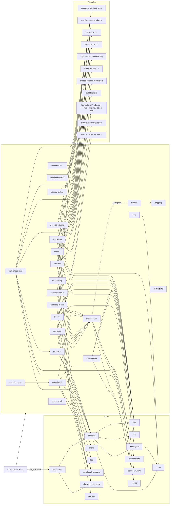

# pstack: how playbooks and skills connect, and how we adopt the pattern

Snapshot: pstack v0.15.36, `cursor_plugins` at upstream main `4dd1d05`
(2026-10-29), read 2026-10-30. Earlier analysis: v0.15.9 at `e43c7ee`
(2026-10-03). Bead `cr-4bvn`. Revision 3: rewritten to the owner's ruling
on form (option D, a router skill, 2026-10-31), after critic round 3.
Revision 4 (2026-10-31): aligned with the unit-kind rules
(`.repo-context/unit-kinds.md`, cited by rule ID such as R7 or St2) and the
owner's rulings of the same day. The router now ships, is model-invocable,
stays on through one `AGENTS.md` line and absorbs `skill-router`; steps have
local IDs and no vocabulary of their own; skills stay model-invocable and
principles are router-only; §6 marks each decision settled, superseded or
open. Why: the rules and rulings came after revision 3 and overturn parts of
§5 and §6. The review of pstack itself (§1–§3) and the comparison (§4) are
unchanged except where they described the router's form.

Path aliases in citations: `P/` is `reference_harnesses/cursor_plugins/pstack/`;
`PB/` is `P/skills/poteto-mode/playbooks/`. A bare `:N` cites the file of the
nearest full citation before it; in §2.1–2.23 it cites the playbook file named
in the subsection's heading. **J:** marks my judgement: comparison verdicts,
priorities and every recommendation are judgements, and a table column or
section headed "(J)" is judgement throughout. Everything else is read from the
cited lines. "Inferred" marks a claim I reasoned to but did not see stated.

## Summary

**What pstack is.** A Cursor plugin by Lauren Tan (`P/plugin.json:4-7`) that
also installs into Claude Code (`P/README.md:21-30`). It ships 58 skills, 2
agents and 1 dormant automation pack. One skill, `poteto-mode`, is the front
door: you type `/poteto-mode <task>`, it picks one of 23 playbooks and runs the
other skills as the playbook's steps need them (`P/README.md:47`,
`P/docs/guide/02-poteto-mode.md:3`).

**The split, in three sentences.**

1. A **skill** is one capability with its own slash command, such as `how`
   (explain code), `architect` (design before code) or a `principle-*`
   lens: one theme that often holds several rules
   (`P/skills/poteto-help/SKILL.md:66-101`, `:135`;
   `P/skills/principle-foundational-thinking/SKILL.md:11-21`).
2. A **playbook** is a procedure for one kind of work, mostly numbered steps,
   with no frontmatter and no slash command, reached only through
   `poteto-mode`; its steps are copied into the todo list and each step names
   the skills, principles or other playbooks it uses
   (`P/skills/poteto-help/SKILL.md:122`, `P/skills/poteto-mode/SKILL.md:124`).
3. Many playbooks reuse the same few skills (`how` in 7, `architect` in 5,
   `show-me-your-work` in 5, `sequence-verifiable-units` in 7). The
   `opening-a-pr` playbook says it runs at the end of every other playbook
   (`PB/opening-a-pr.md:3`); ten call it explicitly, while the read-only ones
   and `prototype` hand back without a PR (§2.24).

**What we lack.** **J:** our harness already has ordered cross-skill
procedures (the execution task loop, our curation playbook, the task engine,
§4). What is missing is a discoverable index of procedures by kind of work,
a uniform form the registry can compare against upstream, and specific steps
listed per playbook in §4.2 (1 equivalent, 16 partial, 6 absent).

**Recommendation.** The owner ruled the form on 2026-10-31: option D, one
router skill, `mvp-mode` (`.claude/skills/mvp-mode/`), with an ordered step
list in every playbook. The same day's rulings and the unit-kind rules fix the
rest of the router:

- It is the only router; `skill-router` retires into it (R1).
- It is model-invocable, and one `AGENTS.md` line tells agents to invoke it
  at the start of a task, so it stays on across tasks and compaction on every
  vendor (R5, R7). It ships with the plugin; there is no root-only `exclude`
  line.
- It lists every playbook and every principle by situation, and skills in
  two layers: always-loaded lines for skills whose description alone would
  miss or collide, and the generated full catalog, loaded when unsure (R3).
- Inside a delegated task it routes to skills and principles only and never
  starts a playbook (R8).

Each playbook is `playbooks/<name>.md`: ordered steps with local IDs
(`bug-fix#3`), each with a condition, its own actions (each described by a
trait) and its calls (each to a unit, called whole: B3, St1). A playbook
holds only the traits it delivers itself: its gates, ordering rules and own
actions; a call is not a trait (T3). There is no separate step vocabulary:
the playbooks' step lists are the source, a generated index shows where a
trait or call recurs, and changes are recorded per step (St2, St3). Skills
stay model-invocable by default, principles are router-only, and a bypass
trial on the first pilot decides which wrapped skills become router-only
(S7, S8, P7). Pilot on `bug-fix`, `multi-phase-plan`, `session-pickup` with
`pause-safely`, then measure before tracing every playbook (St5). Our
curation playbook stays at its path and is compared there; whether it
does so as a logged deviation from B1 and R3 or is routed is open (15).
Keep workflow graphs for unattended build loops, and link them to steps
later through ADR 0003's named methods.

**Open decisions** (§6): whether pstack's playbooks are ruled whole before
the step build (7) and the router's hash (9). Ruled 2026-11-01: review order
(8), pause commits (13), the UI boundary (14), and the root-only curation
playbook, which stays unrouted as a logged deviation (15).

## 1. Structure at v0.15.36

### 1.1 Kinds of thing

| Kind | Count | What it is | How it is invoked |
|---|---|---|---|
| Router mode | 1 | `poteto-mode`: always-on triggers, a principles index, autonomy, subagent and reply rules, the playbook index (`P/skills/poteto-mode/SKILL.md:13-150`) | User types `/poteto-mode`; `disable-model-invocation: true` (`P/skills/poteto-mode/SKILL.md:4`). It stays on only as a Cursor Custom Mode (`P/skills/poteto-help/SKILL.md:54-58`) |
| Playbooks | 23 | Procedures in `PB/*.md`. By convention they open with an ownership line and end with a **Reply:** contract (for example `PB/bug-fix.md:3`, `PB/bug-fix.md:15`). Exceptions: `worktree-cleanup` starts with its steps (`PB/worktree-cleanup.md:3`); `autopilot-stack` starts by composing another playbook (`PB/autopilot-stack.md:3`); `opening-a-pr` has neither (`PB/opening-a-pr.md:3`); `babysit` ends on a routing line, not a Reply (`PB/babysit.md:23`) | Only by the router's match (`P/skills/poteto-mode/SKILL.md:124`); "no slash command" (`P/skills/poteto-help/SKILL.md:122`) |
| Workflow skills | 15 | Multi-step capabilities: how, why, architect, arena, swarm, interrogate, figure-it-out, show-me-your-work, reflect, recall, teach, blast-radius, correct, automate-me, sharpen. Several spawn subagents (`P/skills/arena/SKILL.md:9`); others are inline procedures: `sharpen` is one prompt-rewriting instruction (`P/skills/sharpen/SKILL.md:7-16`), and a text search finds no subagent instruction in `correct` or `blast-radius` (inferred from the search) | Slash command, or named by the router or a playbook. Several open their own phase todo list (`P/skills/architect/SKILL.md:13`, `P/skills/arena/SKILL.md:9`, `P/skills/swarm/SKILL.md:11`) |
| Principle skills | 24 | `principle-*` (`P/README.md:225`): one theme each, not one mechanism. `foundational-thinking` holds data-structures-first, abstraction restraint, concurrency isolation, scaffold-first, coherent increments and subtraction first (`P/skills/principle-foundational-thinking/SKILL.md:11-21`); `laziness-protocol` holds consolidate-decisions and minimize-the-diff (`P/skills/principle-laziness-protocol/SKILL.md:9-10`) | Read by name from the router's index (`P/skills/poteto-mode/SKILL.md:41`) or a playbook step; users rarely type them (`P/skills/poteto-help/SKILL.md:135`) |
| Utility skills | 18 | Writing (unslop, technical-writing, bro, no-comments), checks (tdd, benchmark-checklist, typescript-best-practices), catch-up (ketchup, ketchup-video, in-your-own-words), verification builders (create-/maintain-verification-skill, create-/maintain-formal-verification-skill, statechart), setup (setup-pstack, poteto-help), make-bot-ui | Slash command; some are named by the router or playbooks |
| Agents | 2 | `poteto-agent`, the delegate for playbook steps (`P/agents/poteto-agent.md:3`); `comment-sicko`, the comment reviewer (`P/agents/comment-sicko.md:3`) | Spawned as `subagent_type` (`P/skills/poteto-mode/SKILL.md:94`) |
| Automations | 1 pack | `benny`: Slack issue triage and repro automations, dormant until set up (`P/automations/benny/README.md:3-5`) | Cursor Automations, not slash skills |
| Scripts | 4 | `check-plan.mjs`, `watch-pr`, `worktree-audit.sh`, `bootstrap.ts` in `P/skills/poteto-mode/scripts/` | Named by playbook steps (`PB/multi-phase-plan.md:10`, `PB/babysit.md:12`, `PB/worktree-cleanup.md:3`) |

Counts: 58 skill folders = 1 router + 24 principles + 15 workflow + 18 utility.
The workflow/utility line is my grouping (**J**); pstack does not draw it.
Only `setup-pstack` lacks `disable-model-invocation`, so it is the only skill
that loads from the user's words (`P/skills/poteto-help/SKILL.md:42`).

The router has five dispatch surfaces (inferred from its sections): triggers
that fire mid-task (`P/skills/poteto-mode/SKILL.md:17-37`), the principles
index (`:39-80`), autonomy (`:82-90`), subagent defaults (`:92-102`), and the
playbook match (`:122-150`). A large or cross-cutting task, or one the user
steps away from, overrides a narrower playbook and goes to the
`figure-it-out` skill, which designs a bespoke playbook (`:126`,
`P/skills/figure-it-out/SKILL.md:9`).

### 1.2 What changed since v0.15.9 that matters here

75 commits touch `pstack/` between `e43c7ee` and `4dd1d05`; most of the 522
changed files are the new `statechart` skill's scripts and test corpus.

| Change | Evidence | Why it matters for us |
|---|---|---|
| Playbook set unchanged: still 23 | `P/README.md:53`; same file list at both shas | The earlier inventory of playbooks still holds |
| Router lost `mode: true` and `reminder:`; `name` is now `poteto-mode` | `P/skills/poteto-mode/SKILL.md:1-7`; the old fields are described at `harness_lifecycle/archive/harness-comparisons/pocock-pstack-ours/pstack-explained.md:22-25` | Stickiness now comes from Cursor's Custom Mode, not frontmatter (`P/skills/poteto-help/SKILL.md:54-58`) |
| Playbook files found by naming rule, not links | `P/skills/poteto-mode/SKILL.md:124` | The index is a list of names; the file name is derived |
| New first-message trigger: restate the user's goal, problem and smallest change | `P/skills/poteto-mode/SKILL.md:19` | Every playbook now starts with a goal restatement. The router trigger came in commit `ab1f702`; the separate `in-your-own-words` skill came earlier in `7d8d909`, which did not touch the router |
| Orchestrate rewritten: agentic, the `orch` state scripts deleted | `PB/orchestrate.md:5`; commit `c742dd6` | pstack moved program state from code back to prose; ours keeps it in code (`.claude/skills/execution/SKILL.md:66-81`) |
| `interrogate` rewritten: adversaries must prove each finding by a run; its four reference files deleted | `P/skills/interrogate/SKILL.md:9`, `:19` | The review skill that `feature` and `bug-fix` call now has a different contract |
| 8 new skills (50 → 58): poteto-help, ketchup, ketchup-video, sharpen, in-your-own-words, create-/maintain-formal-verification-skill, statechart | `git diff --name-status` | Only `ketchup` is called by a playbook (`PB/autopilot-full.md:22`) |
| Model defaults and "match the model to the job" | `P/skills/poteto-mode/SKILL.md:96-98` | Playbooks pick a model per role; not our concern (we use a roster) |
| Claude Code adapter | `P/docs/harness/claude-code.md:12` | In Claude Code, "run another pstack skill" means `Read` its SKILL.md, because the Skill tool refuses most of them |

Correction to the archived analysis: it says `blast-radius` is "reached only
from PB orchestrate" (`harness_lifecycle/archive/harness-comparisons/pocock-pstack-ours/pstack-explained.md:207`).
At `e43c7ee` the only match is the phrase "high-blast-radius" on line 87 of
`git show e43c7ee:pstack/skills/poteto-mode/playbooks/orchestrate.md`, which
names no skill. No playbook calls `blast-radius`,
then or now.

## 2. Playbooks

Notation per step: **S** skill, **P** principle, **B** another playbook, **X**
outside pstack (Cursor built-ins and the `cursor-team-kit` plugin: `/loop`,
`create-skill`, `deslop`, `control-ui`, `control-cli`). A step with no calls
is the agent's own work. Every playbook also inherits the router's triggers
(§1.1), so these lists show only what the playbook itself names.

### Understand (read-only, no PR)

**2.1 Investigation** (`PB/investigation.md`). Trigger: a read-only question:
how, why, are we sure, X or Y (`P/skills/poteto-mode/SKILL.md:128`).

1. Route through S `how`; for motivation, also S `why` (`:7`).
2. Throughput checkpoint is one line, n/a (`:8`).
3. Produce `how`-shaped output, or a recommendation with a tradeoffs table (`:9`).
4. Apply S `unslop` to the reply (`:10`).

No PR and no `architect`; a change hands back to Bug fix or Feature (`:12`).

**2.2 Runtime forensics** (`PB/runtime-forensics.md`). Trigger: a live
symptom (leak, spin, glitch); deliverable is a diagnosis (`:3`).

1. Capture the live signal via X control skill (`:5`).
2. Reduce to the smoking gun; parse large artifacts in a subagent, P `guard-the-context-window` (`:6`).
3. Prove the mechanism by injected instrumentation (`:7`).
4. Map to file, symbol, line (`:8`).
5. Throughput checkpoint n/a (`:9`). Hands back to B bug-fix or B perf-issue (`:11`).

**2.3 Trace forensics** (`PB/trace-forensics.md`). Trigger: a captured
profile, trace or heap snapshot handed over after the fact (`:5`).

1. Identify the format, load it; parse in a subagent, P `guard-the-context-window` (`:7`).
2. Dump to sqlite before reading (`:8`).
3. Narrow to the cause: hot path, retainer chain, stuck thread (`:9`).
4. Attribute to source via the artifact's symbols (`:10`).
5. Confirm with a paired capture, else label it the strongest hypothesis (`:11`).
6. Hand back a cited diagnosis; route to B bug-fix or B perf-issue (`:12`).

### Change code

**2.4 Bug fix** (`PB/bug-fix.md`). Trigger: a reported defect to reproduce,
root-cause and fix with runtime evidence (`P/skills/poteto-mode/SKILL.md:129`).
Gate: every shipped line traces to runtime evidence; refuted hypotheses are
reverted (`:5`).

1. Reproduce it yourself on the matching surface, X control skill (`:7`).
2. Binary-search the cause; seed hypotheses with S `how` and S `why`; drive a long hunt with X `/loop`; confirm the mechanism before the S `architect`/S `interrogate` fan-out (`:8`).
3. Plan the fix; S `architect` if it crosses a function boundary; delegate to a subagent (`:9`).
4. Verify on the same surface; "inconclusive" is not a pass (`:10`).
5. Land the failing repro before the fix; S `tdd` when a cheap local test exists; P `sequence-verifiable-units` (`:11-12`).
6. Run B opening-a-pr (`:13`).

**2.5 Perf issue** (`PB/perf-issue.md`). Trigger: a measured slowness to
improve against a baseline (`P/skills/poteto-mode/SKILL.md:130`).

1. Baseline trace via X control skill; vet every number with S `benchmark-checklist` (`:5`).
2. S `how` to ground hypotheses; try the seven performance mantras in order, cheapest first (`:6-16`).
3. Plan from the trace; S `architect` if cross-boundary; delegate; post-fix trace; P `sequence-verifiable-units` (`:17-18`).
4. Parse and compare the artifacts (`:19`).
5. Cite the measurement in the PR (`:20`).
6. Run B opening-a-pr (`:21`). Sustained work goes to B hillclimb (`:23`).

**2.6 Hillclimb** (`PB/hillclimb.md`). Trigger: sustained improvement of one
metric against a target (`P/skills/poteto-mode/SKILL.md:131`). Gate: one
change, one measurement, keep or revert; P `prove-it-works` (`:5`).

1. Ground workload and architecture with S `how`; fix one metric and a stop predicate with a floor on attempts (`:7`).
2. Build, prove and freeze the harness, P `build-the-lever`; vet it with S `benchmark-checklist`; record the baseline (`:8`).
3. Open the decision log via S `show-me-your-work` (`:9`).
4. Ground each hypothesis; order perf hypotheses by B perf-issue's mantras (`:10`).
5. Loop one hypothesis per iteration: delegate, P `guard-the-context-window`; parallel worktrees, P `separate-before-serializing-shared-state`; measure, gate, keep or revert; one commit per win; P `sequence-verifiable-units`; borrow B autonomous-run's wake only (`:11-16`).
6. Push past the first plateau; keep simplifications, P `laziness-protocol` (`:17`).
7. Stop at the predicate or when ideas are marginal (`:18`).
8. Run B opening-a-pr, wins stacked in order (`:19`).

**2.7 Feature** (`PB/feature.md`). Trigger: new or changed behavior, built
from a named data shape (`P/skills/poteto-mode/SKILL.md:134`).

1. S `how` over the affected subsystem (`:5`).
2. S `architect` for parallel design exploration (`:6`).
3. Write the throughput checkpoint as four todos; P `separate-before-serializing-shared-state` (`:7-11`).
4. Delegate code with a named data shape, P `model-the-domain`; S `arena` when several shapes are valid; mandatory review separation that P `laziness-protocol` does not override (`:12`).
5. Verify on the matching surface (`:13`).
6. Rebase into small ordered commits, P `sequence-verifiable-units` (`:14-15`).
7. S `interrogate` if the design is contested (`:16`).
8. Run B opening-a-pr (`:17`).

**2.8 Refactoring** (`PB/refactoring.md`). Trigger: behavior-preserving change
to structure (`P/skills/poteto-mode/SKILL.md:135`); large work goes to S
`figure-it-out` (`:5`).

1. Pin the behavior contract: S `how`, then a characterization test (`:7`).
2. Name the missing structure, P `model-the-domain` (`:8`).
3. Name the target shape, P `foundational-thinking`, P `redesign-from-first-principles`; S `architect` if cross-boundary (`:9`).
4. Subtract before adding, P `subtract-before-you-add`, P `laziness-protocol` (`:10`).
5. Move in small green steps; migrate callers and delete in one wave, P `migrate-callers-then-delete-legacy-apis`; delegate mechanical edits (`:11`).
6. Prove behavior unchanged on the real artifact, P `prove-it-works`; X control skill for smoke runs (`:12`).
7. Keep only if reader load drops, P `minimize-reader-load` (`:13`).
8. Ordered commits, P `sequence-verifiable-units`; run B opening-a-pr (`:14`).

**2.9 Prototype** (`PB/prototype.md`). Trigger: a throwaway sketch to make a
design decision or settle an observable fork (`P/skills/poteto-mode/SKILL.md:136`).
Inverts P `laziness-protocol`'s smallest change (`:5`). Listed here by its
trigger, but it ships no code: it ends in a throwaway decision and a handoff,
not in opening-a-pr (`:12-14`).

1. Scope the decision; no decision routes to B feature (`:7`).
2. Gather references when the space is open (`:8`).
3. Build throwaway in a scratch dir (`:9`).
4. Variants behind one switcher, P `exhaust-the-design-space` (`:10`).
5. Verify by observation; X control skill for screenshots (`:11`).
6. Present a recommendation; hand to B feature or S `architect` (`:12`).

The router also sends any "which approach" question that a run could answer
here instead of asking the user (`P/skills/poteto-mode/SKILL.md:21`).

**2.10 Visual parity** (`PB/visual-parity.md`). Trigger: pixel-exact UI
equivalence (`P/skills/poteto-mode/SKILL.md:137`).

1. Baseline harness first (`:5`).
2. Hold anti-shortcut clauses: no harness or baseline edits (`:6`).
3. One component at a time, one owner per worktree, P `separate-before-serializing-shared-state` (`:7`).
4. Image-diff each against the baseline via X control skill, under X `/loop` (`:8`).
5. Run B opening-a-pr per component or batch (`:9`).

**2.11 Authoring or modifying a skill** (`PB/authoring-a-skill.md`). Trigger:
writing or editing a SKILL.md (`P/skills/poteto-mode/SKILL.md:138`).

1. Use X `create-skill` (`:5`).
2. Validate frontmatter, referenced files, cross-skill links (`:6`).
3. Test cases if structural (`:7`).
4. Run B opening-a-pr (`:8`).

Style rule cites P `encode-lessons-in-structure` (`:10`).

**2.12 Eval** (`PB/eval.md`). Trigger: testing how a skill, structure or
prompt change affects agent behavior (`P/skills/poteto-mode/SKILL.md:139`).
Seven blinding rules come first (`:5-13`).

1. Frame the variant and a rubric for the judge only (`:17`).
2. Sanitized per-candidate environments (`:18`).
3. One organic prompt (`:19`).
4. N parallel candidates per S `arena` Phase B (`:20`).
5. One blinded judge per S `arena` Phase C (`:21`).
6. Grade chain-following from transcripts, not self-report (`:22`).
7. Read every output yourself and synthesize (`:23`).

### Land

**2.13 Opening a PR** (`PB/opening-a-pr.md`). Trigger: "invoked at the end of
every other playbook" (`:3`). It is a rule set in ten bold sections, not a
numbered list: Worktree, Commits, PRs, Titles, Descriptions, Forge, Built-in PR
tool, Size and stacks, Readiness, Babysit (`:5-34`). Calls: X `deslop`, S
`no-comments`, S `technical-writing`, S `unslop` (`:9`); B shipping for stack
moves (`:28`); B babysit only when asked (`:32-34`).

**2.14 Babysit** (`PB/babysit.md`). Trigger: any PR-status request
(`P/skills/poteto-mode/SKILL.md:33`).

1. Declare the mode (`drive`, `background`, `threads-only`, `check`) and resolve the forge (`:7`).
2. Work the merge frontier only (`:8`).
3. One babysitter per stack (`:9`).
4. Never mutate stack topology; the B autopilot-full owner exception (`:10`).
5. Order: conflicts, then threads, then CI (`:11`).
6. Trust the forge's verdict via the `watch-pr` script under X `/loop` (`:12-18`).
7. Classify CI before any retrigger (`:19`).
8. Triage review bots skeptically per `bugbot-triage.md` (`:20`).
9. Stop at the human's line; landing is B shipping (`:21-23`).

**2.15 Shipping** (`PB/shipping.md`). Trigger: land a green stack
(`P/skills/poteto-mode/SKILL.md:34`).

1. Resolve the forge; one independent verifier per PR via X control skill (`:5`).
2. Land only the contiguous verified run from the root (`:6`).
3. Re-check verdicts by `git patch-id` (`:7`).
4. Land bottom-up, read each merge back (`:8`).
5. Leave the stack alone; watch with B babysit's watcher under X `/loop` (`:9`).
6. Stop at the ceiling (`:10`).

### Long runs and programs

**2.16 Autonomous run** (`PB/autonomous-run.md`). Trigger: "run until done"
(`P/skills/poteto-mode/SKILL.md:142`).

1. State the exit predicate (`:5`).
2. Pick the wake mechanism with X `/loop` (`:6`).
3. Smallest evidenced change per iteration, P `sequence-verifiable-units` (`:7-8`).
4. Fix supporting discoveries yourself via `poteto-mode` (`:9`).
5. Checkpoint every iteration via S `show-me-your-work` (`:10`).
6. Stop only at the predicate (`:11`).

**2.17 Orchestrate** (`PB/orchestrate.md`). Trigger: a standing multi-day
program (`P/skills/poteto-mode/SKILL.md:143`). A rule set in two parts,
Topology (6 rules) and Supervision (6 rules) (`:7-23`), not a numbered list.
It names no skill or principle as a step; it distinguishes itself from B
autonomous-run and S `figure-it-out` (`:3`) and uses X control skills for
local-only work (`:10`).

**2.18 Autopilot-full** (`PB/autopilot-full.md`). Trigger: a queue of
independent PRs run to merged (`P/skills/poteto-mode/SKILL.md:144`).

1. The operator's gates first (`:7`).
2. One owner per PR: build, B opening-a-pr, prove, B babysit; X `deslop` and S `no-comments` before code-ready; trail via S `show-me-your-work` (`:8-12`).
3. Owners in parallel off trunk (`:13`).
4. Swarm-verify once via S `swarm`, with a live lane through X control skill (`:14-16`).
5. Merge only what was verified on the trunk it lands on; B shipping's patch-id rule (`:5`, `:17-19`).
6. Root layer: countersign gate loosening; hourly X `/loop` audit; S `ketchup` to catch the operator up (`:20-22`).
7. Stand down on the operator's stop (`:23`).

**2.19 Autopilot-stack** (`PB/autopilot-stack.md`). Trigger: autopilot without
the merge (`P/skills/poteto-mode/SKILL.md:145`). Runs B autopilot-full with two
overrides: stop at verified (replaces its step 5), and stack a PR on the PR it
builds on per B opening-a-pr (replaces its step 3) (`:3-6`).

**2.20 Multi-phase or multi-PR plan** (`PB/multi-phase-plan.md`). Trigger:
work spanning phases or stacked PRs (`P/skills/poteto-mode/SKILL.md:148`).
The plan is the deliverable (`:3`).

1. Skip the plan for one or two obvious files (`:5`).
2. Settle open questions by B prototype; ask only preference calls, P `never-block-on-the-human` (`:6`).
3. Explore in subagents, P `guard-the-context-window` (`:7`).
4. Fill the fixed skeleton, one section per PR, P `sequence-verifiable-units`; name the execution playbook: B autopilot-full, B autopilot-stack or B orchestrate (`:8`).
5. Write with S `technical-writing`, then S `unslop` (`:9`).
6. Lint with `check-plan.mjs`, P `encode-lessons-in-structure` (`:10`).
7. Hand back and stop (`:11`).

Verification rule: unit, live and perf boxes, ten S `swarm` lanes through X
control skill, P `prove-it-works` (`:13-15`). The skeleton itself names B
opening-a-pr, S `no-comments`, X `deslop`, B shipping, S `how`, S
`interrogate` and S `show-me-your-work` (`:39`, `:57-59`, `:66-67`, `:152`).

### Session

**2.21 Session pickup** (`PB/session-pickup.md`). Trigger: resume a prior
agent's work (`P/skills/poteto-mode/SKILL.md:146`).

1. Locate the prior trail; parse long transcripts in a subagent, P `guard-the-context-window` (`:5`).
2. Reconstruct operational state; the trail is authoritative (`:6`).
3. Diff done against pending; name the resume point (`:7`).
4. Route the rest to the matching playbook (`:8`).
5. Verify inherited claims on the real artifact, P `prove-it-works` (`:9`).

**2.22 Pause safely** (`PB/pause-safely.md`). Trigger: an explicit pause,
going offline, a restart or imminent compaction (`P/skills/poteto-mode/SKILL.md:147`).

1. Stop at a safe boundary; cancel nested subagents (`:5`).
2. No irreversible action to pause (`:6`).
3. One `wip:` commit (`:7`).
4. Resume note off-context; point at the S `show-me-your-work` trail if one exists (`:8`).

**2.23 Worktree and simulator cleanup** (`PB/worktree-cleanup.md`). Trigger:
reclaim disk (`P/skills/poteto-mode/SKILL.md:149`).

1. Snapshot and audit with `worktree-audit.sh`, P `build-the-lever`, P `encode-lessons-in-structure` (`:3`).
2. The bucket is advice; the pinned set wins, P `prove-it-works` (`:4`).
3. Verify usage in subagents, P `guard-the-context-window` (`:5`).
4. Pause on irreversible loss (`:6`).
5. Prune the confirmed set (`:7`).
6. Simulators and caches (`:8`).

**2.24** The router lists 23 entries; §2.1–2.23 cover them. "Opening a PR" is
called by name from 10 playbooks: bug-fix, perf-issue, hillclimb, feature,
refactoring, visual-parity, authoring-a-skill, autopilot-full,
autopilot-stack and multi-phase-plan (its template). The router's line
"invoked at the end of every other playbook" (`P/skills/poteto-mode/SKILL.md:150`)
is broader than these calls: the three read-only playbooks hand back a
diagnosis or answer (`PB/investigation.md:12`, `PB/runtime-forensics.md:11`,
`PB/trace-forensics.md:12`), prototype hands back a throwaway decision
(`PB/prototype.md:12-14`), and session-pickup ends by routing
(`PB/session-pickup.md:8`).

### 2.25 Playbook × skill matrix

Cells: step number whose text names the skill (a direct mention). A mention
is not always an invocation: bug-fix step 2 names `interrogate` only to order
it after the mechanism is confirmed, and bug-fix step 5 names
`sequence-verifiable-units` as the principle the step embodies
(`PB/bug-fix.md:8`, `:12`); §5.3 keeps such references apart from calls. `t` = in multi-phase-plan's template
or rules; `r` = in the reply; `PRs` = opening-a-pr's PRs section; `intro` =
named before the steps as the route for larger work. Columns are every pstack skill any playbook
names. pstack skills no playbook names: recall, reflect, correct,
automate-me, teach, bro, blast-radius, sharpen, in-your-own-words,
ketchup-video, poteto-help, setup-pstack, make-bot-ui,
typescript-best-practices, create-verification-skill,
maintain-verification-skill, create-formal-verification-skill,
maintain-formal-verification-skill, statechart (plus `poteto-mode`, the router
itself, and the 24 principles, which have their own table below).

| Playbook | how | why | architect | arena | swarm | interrogate | tdd | benchmark-checklist | show-me-your-work | ketchup | no-comments | technical-writing | unslop | figure-it-out |
|---|---|---|---|---|---|---|---|---|---|---|---|---|---|---|
| investigation | 1 | 1 | | | | | | | | | | | 4 | |
| runtime-forensics | | | | | | | | | | | | | | |
| trace-forensics | | | | | | | | | | | | | | |
| bug-fix | 2 | 2 | 2, 3 | | | 2 | 5 | | | | | | | |
| perf-issue | 2 | | 3 | | | | | 1 | | | | | | |
| hillclimb | 1 | | | | | | | 2 | 3 | | | | | |
| feature | 1 | | 2 | 4 | | 7 | | | | | | | | |
| refactoring | 1 | | 3 | | | | | | | | | | | intro |
| prototype | | | 6 | | | | | | | | | | | |
| visual-parity | | | | | | | | | | | | | | |
| authoring-a-skill | | | | | | | | | | | | | | |
| eval | | | | 4, 5 | | | | | | | | | | |
| opening-a-pr | | | | | | | | | | | PRs | PRs | PRs | |
| babysit | | | | | | | | | | | | | | |
| shipping | | | | | | | | | | | | | | |
| autonomous-run | | | | | | | | | 5 | | | | | |
| orchestrate | | | | | | | | | | | | | | intro |
| autopilot-full | | | | | 4 | | | | 2 | 6, r | 2 | | | |
| autopilot-stack | | | | | | | | | | | | | | |
| multi-phase-plan | t | | | | t | t | | | t | | t | 5 | 5 | |
| session-pickup | | | | | | | | | | | | | | |
| pause-safely | | | | | | | | | 4 | | | | | |
| worktree-cleanup | | | | | | | | | | | | | | |
| **Playbooks using it** | 7 | 2 | 5 | 2 | 2 | 3 | 1 | 2 | 5 | 1 | 3 | 2 | 3 | 2 |

**Playbook × principle.** Only 15 of 24 principles are named by any playbook.
Step numbers as above.

| Principle | Playbooks (step) |
|---|---|
| sequence-verifiable-units | bug-fix 5, perf-issue 3, hillclimb 5, feature 6, refactoring 8, autonomous-run 3, multi-phase-plan 4 |
| guard-the-context-window | runtime-forensics 2, trace-forensics 1, hillclimb 5, multi-phase-plan 3, session-pickup 1, worktree-cleanup 3 |
| prove-it-works | hillclimb (gate), refactoring 6, multi-phase-plan (rule), session-pickup 5, worktree-cleanup 2 |
| laziness-protocol | hillclimb 6, feature 4, refactoring 4, prototype (inverted) |
| separate-before-serializing-shared-state | hillclimb 5, feature 3, visual-parity 3 |
| encode-lessons-in-structure | authoring-a-skill (rule), multi-phase-plan 6, worktree-cleanup 1 |
| model-the-domain | feature 4, refactoring 2 |
| build-the-lever | hillclimb 2, worktree-cleanup 1 |
| foundational-thinking, redesign-from-first-principles, subtract-before-you-add, migrate-callers-then-delete-legacy-apis, minimize-reader-load | refactoring 3, 3, 4, 5, 7 |
| exhaust-the-design-space | prototype 4 |
| never-block-on-the-human | multi-phase-plan 2 |
| Not named by any playbook (router index or skills only) | attack-the-premise, boundary-discipline, type-system-discipline, make-operations-idempotent, outcome-oriented-execution, experience-first, fix-root-causes, test-behavior-not-implementation, explain-the-number |

**Playbook × playbook.** opening-a-pr ← 10 playbooks (§2.24); babysit ←
opening-a-pr, autopilot-full, shipping; shipping ← babysit, autopilot-full,
multi-phase-plan, opening-a-pr; perf-issue ← hillclimb (mantras),
runtime-forensics, trace-forensics; bug-fix ← runtime-forensics,
trace-forensics, investigation; feature ← prototype, investigation;
autonomous-run ← hillclimb (wake only); prototype ← multi-phase-plan, the
router's ask trigger; autopilot-full ← autopilot-stack, multi-phase-plan,
babysit; autopilot-stack and orchestrate ← multi-phase-plan; any playbook ←
session-pickup step 4.

### 2.26 Diagram

Main edges only; X externals and template-only calls omitted.



Skill-to-skill edges shown: `architect` runs `how`, `why`, `arena` and
offers `interrogate` (`P/skills/architect/SKILL.md:23`, `:29`, `:47`);
`interrogate` reuses `arena`'s phases (`P/skills/interrogate/SKILL.md:17`);
`figure-it-out` runs `architect` and `show-me-your-work`
(`P/skills/figure-it-out/SKILL.md:30`, `:46`). Not shown: `teach` runs `how`
and `why` (`P/skills/teach/SKILL.md:3`); `interrogate` uses
`in-your-own-words` (`P/skills/interrogate/SKILL.md:13`);
`create-formal-verification-skill` points at `statechart`
(`P/skills/create-formal-verification-skill/SKILL.md:35`); `setup-pstack`
offers both verification builders (`P/skills/setup-pstack/SKILL.md:74`, `:78`).

## 3. What makes a playbook a playbook

| Property | Playbook | Skill | Evidence |
|---|---|---|---|
| Invocation | Never typed; chosen once per task by the router's match, or named by another playbook | Own slash command; named by the router or a step | `P/skills/poteto-help/SKILL.md:122`; `P/skills/poteto-mode/SKILL.md:124` |
| Discovery surface | No frontmatter; a one-line entry in the router index | Frontmatter `name` and `description` | `P/skills/poteto-mode/SKILL.md:128-150`; e.g. `P/skills/how/SKILL.md:1-5` |
| State | Owns the task's todo list; steps copied in first, verbatim | A few workflow skills keep their own phase list inside one step | `P/skills/poteto-mode/SKILL.md:124`; `P/skills/architect/SKILL.md:13` |
| Skips are visible | A skipped step stays with `skip: <reason>`; checkpoints keep `n/a: <reason>` | None | `P/skills/poteto-mode/SKILL.md:124`; `PB/feature.md:7` |
| Ordering | Numbered steps; some ordering is a rule inside a step ("conflicts, then threads, then CI") | Phases order one capability's internals, not other capabilities | `PB/babysit.md:11`; `P/skills/arena/SKILL.md:9` |
| Ownership line | Usually opens with "You own X"; not worktree-cleanup, autopilot-stack, opening-a-pr (§1.1) | Opens with what it does | `PB/bug-fix.md:3`; `PB/shipping.md:3`; `P/skills/how/SKILL.md:9` |
| Reply contract | Usually ends with **Reply:** naming its unique content; not opening-a-pr or babysit (§1.1); global reply rules in the router | Has an Output section for its artifact | `P/skills/poteto-mode/SKILL.md:116`; `PB/bug-fix.md:15`; `P/skills/arena/SKILL.md:48` |
| Composition | Calls other playbooks: ten end in opening-a-pr (§2.24); autopilot-stack is autopilot-full with overrides; hillclimb borrows parts of perf-issue and autonomous-run | Calls other skills (architect → arena) | `P/skills/poteto-mode/SKILL.md:150`; `PB/autopilot-stack.md:3`; `PB/hillclimb.md:10`, `:16` |
| Reuse | Thin: a step is often one sentence naming a skill | One skill serves many playbooks (§2.25) | `PB/feature.md:5-6` |
| Gates | Playbook-wide rules sit between the title and the steps | Gates are internal to the skill | `PB/bug-fix.md:5`; `PB/hillclimb.md:5`; `PB/eval.md:5-13` |
| Model choice | A code playbook names its model role | Routed workflow skills set their own models | `P/skills/poteto-mode/SKILL.md:94-96` |
| Precedence | figure-it-out overrides a narrower playbook; Orchestrate and Autonomous run are disjoint | Not applicable | `P/skills/poteto-mode/SKILL.md:126`, `:143` |
| Generation | `figure-it-out` writes a bespoke playbook when none fits | — | `P/skills/figure-it-out/SKILL.md:9`, `:32` |

**J:** three findings matter for the design.

1. Not every playbook is an ordered list. `opening-a-pr` and `orchestrate`
   are rule sets (§2.13, §2.17). A steps format must allow unordered rule
   blocks, or treat them as traits of the playbook.
2. Playbook-wide gates (`PB/bug-fix.md:5`) are mechanisms, not positions. In
   our registry they are traits, not steps.
3. The router's mid-task triggers (`P/skills/poteto-mode/SKILL.md:17-37`)
   fire inside every playbook. They are not steps of any playbook. pstack
   duplicates several of them as explicit steps so a forgotten trigger is
   still carried by the recipe (archived analysis,
   `harness_lifecycle/archive/harness-comparisons/pocock-pstack-ours/pstack-explained.md:245-250`).

## 4. Ours today

### 4.1 Where our procedures live

| Place | What it holds | Evidence |
|---|---|---|
| Skills that are procedures | `systematic-debugging` (5 numbered steps), `performance-optimization` (5), `test-driven-development` (test-first 4), `resolving-merge-conflicts` (5), `research` (4), `codebase-research` (three graduated workflows), `triage` (6), `harness-publish` (5) | `.claude/skills/systematic-debugging/SKILL.md:14-31`; `.claude/skills/performance-optimization/SKILL.md:12-24`; `.claude/skills/test-driven-development/SKILL.md:28-33`; `.claude/skills/resolving-merge-conflicts/SKILL.md:6-15`; `.claude/skills/codebase-research/SKILL.md:112-161`; `.claude/skills/triage/SKILL.md:32-46`; `.claude/skills/harness-publish/SKILL.md:14-66` |
| Execution scopes | `execution` has a task loop and a phase loop; `phase-execution` and `run-phases` are thin entry points into it, like pstack's playbook names | `.claude/skills/execution/SKILL.md:13-19`, `:36-51`, `:55-85`; `.claude/skills/phase-execution/SKILL.md:9-10`; `.claude/skills/run-phases/SKILL.md:9-15` |
| Planning and decision mapping | `planning` routes and decomposes; `wayfinder` maps decision dependencies | `.claude/skills/planning/SKILL.md:10-18`; `.claude/skills/wayfinder/SKILL.md:9-11` |
| A written procedure doc | `harness_lifecycle/playbook.md`: one path for every skill change (intake, evidence, ruling, building, verify, delivery) | `harness_lifecycle/playbook.md:17-26` |
| Workflow graphs | Deterministic graphs run by `workflow_interpreter`: `feature-delivery` (implement → debrief → review → ship gate), `build-loop` (write_tests → review_tests → implement → review_impl → critic → slice_gate), `design-spec`, `integration` | `workflows/feature-delivery.toml:5`, `:20`, `:64`, `:119`, `:180`; `workflows/build-loop.toml:5`, `:25`, `:83`, `:142`, `:195`, `:252`, `:312` |
| Router analogues | AGENTS.md routes phase work to `execution` and handoffs to `delegation`; `skill-router` is optional, "not a startup checklist". Both move to `mvp-mode` (R1, A4) | `AGENTS.md:92`, `:95-96`; `.claude/skills/skill-router/SKILL.md:8-10`, `:12-23` |
| Session start, pause and end | AGENTS.md says recover the active Bead and handoff; the beads core rules give pause (unclaim plus a resume line) and session start and end; workstream mode persists state before recovery and re-reads ledger, phase, Beads and Git after; the task engine recovers from its ledger and open findings | `AGENTS.md:85-87`; `.claude/skills/beads/references/prime.md:87`, `:107-116`; `.claude/skills/beads/references/usage.md:305-310`; `.claude/skills/execution/references/workstream-mode.md:29-35`; `.claude/skills/execution/references/task-engine.md:14-18` |
| Cross-skill orders already written | The task loop applies test-first, security and debugging during implementation, then checks and risk-based review; the curation path orders evidence, ruling, building, verify, delivery and names the authoring and publishing steps; the task engine dispatches through the `delegation` skill before collection and review | `.claude/skills/execution/SKILL.md:38-50`; `harness_lifecycle/playbook.md:21-26`; `.claude/skills/execution/references/task-engine.md:43`, `:60-69` |

Graph nodes carry their own inline instructions (ADR 0002,
`docs/adr/0002-node-instructions.md:35-36`) because the loader has no include
mechanism (`workflows/README.md:65-66`). ADR 0003 already decides how a graph
will name a shared method instead: resolve, copy and freeze it at root
creation (`docs/adr/0003-large-payloads-and-shared-methods.md:116-125`).
Routing in graphs is a table lookup (`docs/adr/0004-deterministic-routing.md:31-32`).

### 4.2 pstack's playbooks against ours

**What "equivalent" means here.** The verdict compares material procedure,
not purpose alone:

- **equivalent**: same purpose, and every material step and ordering rule of
  the upstream playbook has a local counterpart, possibly reworded, split or
  in a routed reference. Only tooling for a surface we lack may differ.
- **partial**: same purpose, but at least one material step or ordering rule
  has no local counterpart.
- **absent**: no local procedure with that purpose.

A purpose match alone is never "equivalent". Each mapping was rechecked
through the references its skill routes to. Verdicts are judgement (J).

| pstack playbook | Our nearest procedure, with routed references | Verdict (J) | What is still missing (J) |
|---|---|---|---|
| investigation | `codebase-research` deep dive (`.claude/skills/codebase-research/SKILL.md:154-161`); skill-router "direct source explanation" (`.claude/skills/skill-router/SKILL.md:21`) | partial | The how/why split, fan-out explorers, and a recommendation with a tradeoffs table; no Grounding skill of ours (`harness_lifecycle/adlc/skill-map.md:27`) |
| runtime-forensics | Live-process stacks and flamegraphs, contention snapshots (`.claude/skills/performance-optimization/references/measurement-recipes.md:21-25`, `:48-50`), routed from `.claude/skills/performance-optimization/SKILL.md:18-21`; instrumentation when no repro exists (`.claude/skills/systematic-debugging/SKILL.md:33-36`) | partial | A diagnosis-only deliverable, reducing large artifacts in a subagent, and proving the mechanism by injecting into the running process (`PB/runtime-forensics.md:3`, `:6-7`). CDP and control-skill capture are browser and app tooling |
| trace-forensics | Analysis of captures we make: cProfile ranking, memray flamegraphs, tracemalloc snapshot diffs (`.claude/skills/performance-optimization/references/measurement-recipes.md:26-33`, `:54-63`); a captured trace as a reproduction (`.claude/skills/systematic-debugging/SKILL.md:14-17`) | partial | A procedure for an artifact handed over after the fact: identify the format, transform to a queryable form, attribute to source, confirm with a paired capture or label the strongest hypothesis (`PB/trace-forensics.md:7-12`) |
| bug-fix | `systematic-debugging` + `test-driven-development` | partial | Worked example §5.3 |
| perf-issue | `performance-optimization` (`.claude/skills/performance-optimization/SKILL.md:12-27`) | partial | The seven mantras in order, cheapest first (`PB/perf-issue.md:6-16`); vetting every number with `benchmark-checklist` (`:5`); comparing the before and after artifacts (`:19`) |
| hillclimb | `performance-optimization` steps 4–5 and its attempt record (`.claude/skills/performance-optimization/SKILL.md:22-31`) | partial | We have one factor at a time, keep or remove by benefit, and an attempt record with baseline, result, decision and reason kept for handoff. Missing: the fixed per-attempt schema read before each attempt (`PB/hillclimb.md:9`), a stop predicate with a floor on attempts (`:7`), proving then freezing the harness (`:8`), pushing past the first plateau (`:17`) |
| feature | `execution` task loop (`.claude/skills/execution/SKILL.md:38-50`); graph `feature-delivery` | partial | The how → architect → throughput-checkpoint sequence before delegation (`PB/feature.md:5-11`); the graph enforces build and review order only |
| refactoring | `test-driven-development` characterization (`.claude/skills/test-driven-development/SKILL.md:39`); `planning` expand → migrate → contract (`.claude/skills/planning/SKILL.md:66-67`); `improve-codebase-architecture` | partial | The parts exist in three skills; nothing orders them |
| prototype | `prototype` skill (`.claude/skills/prototype/SKILL.md:8-28`), with variants in its UI reference (`:18`) | partial | Presenting alternatives, tradeoffs and a recommendation, then handing the chosen direction to Feature or `architect` (`PB/prototype.md:12`); ours records outcome, cases, limits and a pointer, and leaves promotion as separate work (`.claude/skills/prototype/SKILL.md:24-28`). Deliberate local difference: upstream makes observation the test, "not an assertion" (`PB/prototype.md:11`); ours allows a small assertion as the cheapest proof (`.claude/skills/prototype/SKILL.md:20-22`; `.claude/skills/prototype/LOGIC.md:17-19`). The moodboard step (`PB/prototype.md:8`) is UI tooling. Ours is a skill; pstack's is a playbook |
| visual-parity | none | absent | Needs a UI surface |
| authoring-a-skill | `harness_lifecycle/playbook.md` §2 (`harness_lifecycle/playbook.md:21-26`) + `authoring-for-agents` | equivalent | Nothing; ours adds evidence, ruling and a critic, and lands by merge, not by PR |
| eval | none | absent | `harness-evaluate` judges a capability for adoption (`harness_lifecycle/playbook.md:138-140`), not agent behaviour under a change; Evaluation is pstack-only (`harness_lifecycle/adlc/skill-map.md:72`) |
| opening-a-pr | AGENTS.md staging and commit rules (`AGENTS.md:62-65`) | absent | No PR procedure. Small ordered commits and title rules (`PB/opening-a-pr.md:7`, `:11`) are candidate traits |
| babysit | none | absent | Needs PRs and CI; we have no CI (`.repo-context/verification.md:8-9`) |
| shipping | AGENTS.md merge rule (`AGENTS.md:66-68`) | absent | Re-checking verdicts by `git patch-id` (`PB/shipping.md:7`) is Git-generic |
| autonomous-run | `run-phases` → workstream mode (`.claude/skills/execution/references/workstream-mode.md:13-26`) | partial | Ours walks a roadmap; there is no exit-predicate loop (`PB/autonomous-run.md:5`, `:11`) |
| orchestrate | `execution` phase loop, contractor and child workflows (`.claude/skills/execution/SKILL.md:55-103`); coordinator rules (`AGENTS.md:22-24`, `:46-47`) | partial | Same purpose; reading primary evidence and owning verification match (`PB/orchestrate.md:19`). Missing: one owner per PR, a non-author verifier per PR, a sub-coordinator limit, start with one unit before fanning out (`:9`, `:11`, `:13-14`). Ours holds state in code; pstack moved it to prose (`c742dd6`) |
| autopilot-full / -stack | `execution` independent child workflows (`.claude/skills/execution/SKILL.md:92-103`) | partial | A per-PR owner, swarm verification and the merge flow |
| multi-phase-plan | `planning` Decompose and Elaborate (`.claude/skills/planning/SKILL.md:24-62`) | partial | The plan lint script (`PB/multi-phase-plan.md:10`), the fixed per-PR skeleton with evidence boxes (`:8`, `:13-15`), and settling open questions by prototype first (`:6`). Ours adds Beads mapping and a critic for material risk (`.claude/skills/planning/SKILL.md:54-56`) |
| session-pickup | AGENTS.md "recover the active Bead and handoff" (`AGENTS.md:85-87`); beads session start (`.claude/skills/beads/references/prime.md:109`); recovery in workstream mode and the task engine (`.claude/skills/execution/references/workstream-mode.md:29-35`; `.claude/skills/execution/references/task-engine.md:14-18`) | partial | Recovery exists, but only inside execution. Missing: one pickup procedure for any prior trail: reconstruct state, diff done against pending, name the resume point, route the rest (`PB/session-pickup.md:5-8`) |
| pause-safely | beads pause (`.claude/skills/beads/references/prime.md:87`); session close with resume lines (`.claude/skills/beads/references/usage.md:305-310`); persist before recovery (`.claude/skills/execution/references/workstream-mode.md:33-34`) | partial | Stop at a safe boundary and cancel nested subagents (`PB/pause-safely.md:5`). The `wip:` commit (`:7`) conflicts with our commit rule (§4.3) |
| worktree-cleanup | none. We create worktrees (`harness_lifecycle/playbook.md:24`; `.claude/skills/delegation/vendors/codex-cli/dispatch.md:28`), and the engine prunes its own (`workflow_interpreter/foreman/tick.py:1072`) | absent | A Git worktree audit and prune with an uncommitted-work gate (`PB/worktree-cleanup.md:3-7`) applies to us; the simulator and Cursor cache step (`:8`) does not |

Tally: 1 equivalent, 16 partial, 6 absent (autopilot-full and -stack counted
separately). Revision 0 said 5, 11 and 7. Changed: perf-issue, orchestrate,
multi-phase-plan and (revision 2) prototype from equivalent to partial (same
purpose, material steps missing); trace-forensics from absent to partial
(routed measurement recipes).
Runtime forensics, hillclimb, session pickup and pause safely stay partial
with smaller gaps.

**What a playbook layer would add (J).** Ordered cross-skill procedures
already exist: the task loop (`.claude/skills/execution/SKILL.md:38-50`), our
curation path (`harness_lifecycle/playbook.md:21-26`), and the task engine's
dispatch through `delegation` (`.claude/skills/execution/references/task-engine.md:43`).
The missing parts are:

1. **A discoverable index.** Nothing lists "for this kind of work, run this
   procedure". AGENTS.md routes only phase work and handoffs (`AGENTS.md:92`,
   `:95-96`); `skill-router` is optional (`.claude/skills/skill-router/SKILL.md:8-10`).
   Continuity, for example, is spread over five files (the session rows of
   §4.1).
2. **One comparable form.** Our procedures are written as skills, documents,
   references and graphs, so the registry cannot compare them with an upstream
   playbook step by step.
3. **The specific steps** in the table above.

**Recorded conflict.** The archived comparison rejected "sticky mode,
playbook router, and copying steps verbatim into todos"
(`harness_lifecycle/archive/harness-comparisons/pocock-pstack-ours/vs-ours.md:61`).
That was an analysis verdict, never a ledger ruling (no pstack event exists in
`harness_lifecycle/registry/ledger/`). The owner's new direction reverses part
of it. Stickiness was the main objection. Cursor now gets it from a Custom
Mode rather than the skill (§1.2); ours will get it from one `AGENTS.md`
line that has the agent invoke the router (R5, R7). **J:** the objection
weighs less for our router, which carries routing lines and kind definitions
only (R2, R4) and keeps its always-loaded part lean (R3), within the same
per-session budget as `AGENTS.md` (R5). The other rules that conflict with
ours are in §4.3. Decision 1 in §6.

### 4.3 Compatibility: pstack's router and the pilot playbooks against our rules

Dispositions are judgement (J): **adapted** (kept, changed to fit a local
rule), **rejected**, or **kept** (already allowed under an existing rule).

| Upstream rule | Source | Our rule | Disposition (J) |
|---|---|---|---|
| Reversible work and external actions (team chat, tickets, evals) proceed without asking | `P/skills/poteto-mode/SKILL.md:84` | Messages and publishing need authorization (`AGENTS.md:11-12`) | rejected |
| Always pause for irreversible writes | `P/skills/poteto-mode/SKILL.md:86` | `AGENTS.md:11-12`, `:62-68`, stricter | kept |
| "Don't stop", "going to bed" mean keep going | `P/skills/poteto-mode/SKILL.md:88` | Unattended mode needs an explicit request and never widens authority (`.claude/skills/execution/references/workstream-mode.md:3-4`, `:17-19`) | adapted: keep working; authority unchanged |
| Candor; no is an acceptable answer | `P/skills/poteto-mode/SKILL.md:90` | `AGENTS.md:13-14` | kept |
| Every claim carries its evidence or its label | `P/skills/poteto-mode/SKILL.md:114` | `AGENTS.md:15-16` | kept |
| Every step subagent is `poteto-agent`; background by default; a model per role | `P/skills/poteto-mode/SKILL.md:94-98` | Delegate when it helps (`AGENTS.md:42-43`); runtime configuration owns models (`AGENTS.md:72-73`) | rejected |
| Code crossing a function boundary goes to `architect`, which requires parallel arena runners and two candidates | `P/skills/poteto-mode/SKILL.md:23`; `P/skills/architect/SKILL.md:29-33` | Multiple variants are optional (`.claude/skills/codebase-design/SKILL.md:39-41`) | rejected as a default; the local binding is `codebase-design` |
| First message restates the goal and the smallest change | `P/skills/poteto-mode/SKILL.md:19` | none | adapted: a candidate trait for the router's trait review, not a policy |
| An observable "which approach" question goes to a prototype, not the user | `P/skills/poteto-mode/SKILL.md:21` | Decide routine details; ask when material (`AGENTS.md:9-10`) | adapted |
| Copy the steps into the todo list; `skip: <reason>` | `P/skills/poteto-mode/SKILL.md:124` | none | adapted: steps become todos and a skipped step records why (B2; decision 4) |
| bug-fix: reproduce yourself; ask the user only with a stated reason | `PB/bug-fix.md:7` | Request missing evidence when no repro is available (`.claude/skills/systematic-debugging/SKILL.md:35-36`) | adapted |
| bug-fix: delegate investigation and the fix | `PB/bug-fix.md:3`, `:9` | `AGENTS.md:42-43` | rejected as mandatory |
| bug-fix: the failing repro lands in history before the fix | `PB/bug-fix.md:11` | Commit only when authorized (`AGENTS.md:64`) | adapted: applies when committing is authorized |
| session-pickup: the trail is authoritative; do not re-derive or re-verify from scratch | `PB/session-pickup.md:6-7` | Verify consequential claims from summaries and reports against primary evidence (`AGENTS.md:22-24`); reuse valid evidence while it still applies (`.claude/skills/execution/SKILL.md:46-47`) | adapted: reuse inherited state and completed work without redoing it; verify each consequential claim against primary evidence before relying on it. Upstream step 5 already asks this (`PB/session-pickup.md:9`); the adaptation removes the tension with steps 2–3 |
| session-pickup: read the workspace's transcripts; never glob across projects | `PB/session-pickup.md:5` | Private data stays in its scope (`AGENTS.md:59-61`); our trail is Beads, ledger, handoff and Git (`AGENTS.md:85-87`) | adapted; the privacy rule kept |
| pause-safely: one `wip:` commit on the current branch | `PB/pause-safely.md:7` | `AGENTS.md:64` | adapted: commit only under existing authority; otherwise leave the tree and name the dirty paths in the resume line (`.claude/skills/beads/references/prime.md:87`). Standing authority would be a policy change (decision 13) |
| pause-safely: no PR and no push to pause | `PB/pause-safely.md:6` | `AGENTS.md:64` | kept |
| pause-safely: resume note off-context, a `/tmp` file for compaction | `PB/pause-safely.md:8` | Persist in Beads and the ledger (`.claude/skills/execution/references/workstream-mode.md:33-34`) | adapted |
| multi-phase-plan: settle open questions by prototype; ask the operator only preference calls | `PB/multi-phase-plan.md:6` | Ask when ambiguity materially affects correctness, scope or authority (`AGENTS.md:9-10`); ask only about open material scope, dependency or authority choices (`.claude/skills/planning/SKILL.md:20-22`) | adapted: settle an observable question by prototype first; still ask about material scope, dependency or authority choices, not only preferences |
| multi-phase-plan: execution starts only on the operator's explicit go, after the plan is stated | `PB/multi-phase-plan.md:11`, `:34` | Carry authorization through; retain approvals already given (`AGENTS.md:7-8`, `:11-12`); planning-only requests authorize plans, and already authorized implementation continues (`.claude/skills/planning/SKILL.md:20-22`) | adapted: a planning-only request stops at the plan; when implementation is already authorized, continue without a second go |
| multi-phase-plan: explore in subagents; spawn one owner per PR | `PB/multi-phase-plan.md:7`, `:47` | Delegate when it materially helps; keep small work local (`AGENTS.md:42-43`); risk labels decide inline or delegated work (`.claude/skills/execution/SKILL.md:23-29`) | rejected as mandatory; delegate by the local rule |
| multi-phase-plan: unit, live and perf boxes for every PR; ten live lanes; a full swarm per code-ready head | `PB/multi-phase-plan.md:13`, `:65`, `:96-118` | Run applicable checks and broaden only for changes, failures or unresolved risk (`AGENTS.md:51-53`; `.repo-context/verification.md:3-6`); review driven by requirements or risk (`.claude/skills/execution/SKILL.md:46-49`) | adapted: each unit names its evidence box, filled from the applicable checks and the claim → evidence table (`.repo-context/verification.md:11-19`); live and perf boxes only where the component or risk calls for them; no fixed lane count or swarm |
| multi-phase-plan: name the execution playbook (autopilot or orchestrate) | `PB/multi-phase-plan.md:8` | Execution scopes (`.claude/skills/execution/SKILL.md:13-19`) | adapted |
| authoring-a-skill: use `create-skill` and land by PR | `PB/authoring-a-skill.md:5`, `:8` | `authoring-for-agents`; merge delivery (`harness_lifecycle/playbook.md:24-26`) | adapted |

Our multi-phase-plan playbook therefore carries these adapted rules, not
pstack's plan skeleton verbatim: the skeleton's go gate, owner fan-out, lanes
and swarm (`PB/multi-phase-plan.md:34-47`, `:65`, `:96-118`) are replaced by
the dispositions above.

No row prefers an upstream rule over local policy. The only policy change this
report proposes is optional and the owner's call: a standing authority for
`wip:` commits at a pause (decision 13). Every other row adapts to, or stays
inside, AGENTS.md and the local skills it routes to.

## 5. Adoption design

### 5.1 The playbook layer for us

| Form | How it works |
|---|---|
| A. Router skill (pstack's form) | One skill holds the index and rules; `playbooks/*.md` beside it |
| B. One skill per playbook | Each playbook is its own slash-only skill |
| C. Workflow graphs | Each playbook is a TOML graph run by `workflow_interpreter` |
| D. A plus step lists | A, with a machine-readable step list per playbook |
| E. Standalone playbook documents | One document per playbook and an index document, reached by one routing row, conditional pointers or direct file references; no skill |
| F. E plus step lists | E, with the step list in each document's frontmatter |

B adds a catalog entry per playbook and mixes procedures with capabilities,
the split pstack keeps. C is heavy for interactive work: every node needs
inline instructions today (`docs/adr/0002-node-instructions.md:57-58`), and
named shared methods are designed but not built
(`docs/adr/0003-large-payloads-and-shared-methods.md:156-158`). The real
choice is between the router (A, D) and documents (E, F). Revision 2
recommended F. The rows marked † are corrected in this revision, after the
owner asked why not a router (see the notes after the table). Revision 4
updates the router column to the rules (R3, R5, R7, T3, St2); the documents
column is unchanged:

| Criterion | A / D: router skill | E / F: standalone documents |
|---|---|---|
| Discovery † | Explicit and standing: the user types `/mvp-mode <name>`, the model can invoke it from its description, and one `AGENTS.md` line has every agent invoke it at the start of a task (R7). It names every playbook and principle by situation (R3) | Implicit: one row in `.repo-context/docs-index.md`, which is read once per session (`AGENTS.md:85-86`). The model has to match the task to that row from a list it read once. Our curation playbook is reached this way today (`.repo-context/docs-index.md:29`) |
| Invocation | `/mvp-mode <task>`, or by name | By name ("run the bug-fix playbook") or file path. No slash command unless a thin manual alias is added (`.claude/skills/authoring-for-agents/SKILL.md:18`) |
| Composition | By path between playbooks; skills named in steps | The same |
| Registry integration † | The router is one skill entry. Today a skill's `tree_hash` covers every file in its folder (`curation/scan/catalog.py:353-362`), so decision 9 would exclude `playbooks/` from it, and each playbook file is cataloged as its own `playbook` unit. A playbook file is a valid `doc:` ruling target today (`curation/registry/checks/records.py:47-60`). A playbook holds its own gates, ordering rules and own actions as traits (T3), so the holder check needs widening to playbooks and principles (T1) | Any existing file is already a ruling target (`harness_lifecycle/registry/README.md:322`; `curation/registry/checks/records.py:47-60`), with its own hash. A flat `.repo-context/` file can also hold a delivered trait without changing the holder check (`curation/registry/checks/traits.py:78-89`). But ordered steps need registry support in both forms (the step lists, the generated index and its checks; §5.2) |
| Cost per session | Model-invocable: one catalog line, plus the one `AGENTS.md` line and the router's always-loaded part, which count against the `AGENTS.md` budget (R5). Actual exposure depends on the harness (`.claude/skills/authoring-for-agents/references/skill-anatomy.md:14-18`) | One index row |
| Shipping † | Ships through the existing skills source line (`mvp-harness/plugins/mvp-plugin/publish-manifest.txt:20-21`), and does ship (owner ruling, 2026-10-31) | Cannot ship: the plugin copies skills and agents only, and the template leaves out docs (`mvp-harness/plugins/mvp-plugin/scripts/build-template.sh:10-11`) |
| Local precedent | "Repeated specialist workflow: skill" and "Explicit human entrypoint: manual skill or thin alias" (`.claude/skills/authoring-for-agents/SKILL.md:17-18`) | "Convention for particular work: project document with a conditional pointer" (`.claude/skills/authoring-for-agents/SKILL.md:16`); `harness_lifecycle/playbook.md` |
| Todo-copy rule | In the router body | In the index's header |

**What revision 2 weighed wrongly (J).**

- **Registry.** It counted F's fit with today's checks as decisive. But the
  registry does not decide the runtime shape. The holder check must widen to
  playbooks in either form once a playbook holds its own traits (T1, T3).
  Decision 9 addresses the router's hash. The step registry code (§5.2) is
  new in either form.
- **Shipping.** It said the router's shipping advantage counts only once
  playbooks ship, and decision 12 kept them root-only partly because
  documents do not ship. That argument was circular. `.repo-context/` never
  ships with the plugin, a skill folder does, and playbooks are meant to be
  part of our harness.
- **Discovery.** A slash command is explicit. A docs-index row relies on the
  model matching the task from a list it read once.

**Ruled (owner, 2026-10-31): D.** F remains the cheapest fallback if the
ruling is ever reversed. Revision 2 laid F out as flat
`.repo-context/playbook-<name>.md` files with an index document.

**The layout.**

```text
.claude/skills/mvp-mode/
├── SKILL.md                 kind definitions, routing lines, the shared rules
└── playbooks/
    ├── bug-fix.md           its trigger, ordered steps with local IDs, the reply contract
    ├── multi-phase-plan.md
    ├── session-pickup.md
    └── pause-safely.md
```

- **`SKILL.md`.** Frontmatter `name: mvp-mode` and a description. It is
  model-invocable (R7); the `AGENTS.md` line that invokes it at the start of
  a task replaces today's "When needed" routing (A4). The body holds routing
  lines and kind definitions only (R2, R4):
  - **Kinds.** One line defining each kind, so a shipped copy works without
    `.repo-context/unit-kinds.md` (R4).
  - **Always loaded.** Every playbook, by the kind of request it fits; every
    principle, by its situation; and the skills whose description alone would
    miss or collide (R3). A playbook or principle is read by path; a skill is
    invoked through the platform, not read (R6).
  - **When unsure or asked what exists.** The full skill catalog, generated
    by `.claude/scripts/skill-catalog.py` as it generates `skill-router`'s
    catalog today, never hand-written (R3).
  - **Shared rules.** If the user named a playbook, run it; if a task fits an
    index line, run that playbook and say which; if none fits, work without
    one. At run time the steps become todos, and a skipped step stays with
    its reason (B2). Every exit runs the playbook's closeout (B7). Inside a
    delegated task, route to skills and principles only and never start a
    playbook: the parent runs the playbook, and the brief is the delegate's
    step (R8).
- **`playbooks/<name>.md`.** No slash command of its own; a human entry is a
  thin alias skill that names it (B9). It is a playbook because it lives
  here and the router lists it, not because it lacks frontmatter (B1). Each
  step has a local ID (`bug-fix#3`), a condition, its own actions (each
  described by a trait) and its calls (each to a unit, called whole: B3,
  St1). The file ends in a reply contract that also covers stopping early
  (B5). The file is the source of its step list; the registry keeps no
  separate copy (St2).

Illustrative step list (**J**). Nothing here is ruled; the trait IDs marked
"new" do not exist yet. It is the playbook §5.3 ends with. Under B3 the
first step calls `systematic-debugging` whole, so its reproduce, eliminate,
owning-fix, regression-check and rerun technique stays in the skill (S3):

```yaml
# playbooks/bug-fix.md, step list (illustrative)
- id: bug-fix#1
  calls: ["skill:systematic-debugging"]
- id: bug-fix#2
  when: committing is authorized
  actions: [{trait: red-check-lands-first}]          # new: its own action
  calls: ["skill:test-driven-development"]
- id: bug-fix#3
  when: the change is deep
  calls: ["skill:review"]
- id: bug-fix#4
  calls: ["skill:beads"]                             # close with evidence
```

**Our curation playbook (J): it stays at `harness_lifecycle/playbook.md`
and is compared there.**

- **Cost of moving it under the router.** About a dozen live references
  would have to change:
  - the docs-index row (`.repo-context/docs-index.md:29`);
  - two skills (`.claude/skills/harness-scan/SKILL.md:18`,
    `.claude/skills/harness-evaluate/SKILL.md:19`);
  - the lifecycle and registry guides (`harness_lifecycle/README.md:91`;
    `harness_lifecycle/registry/README.md:241`, `:496`, `:552`;
    `harness_lifecycle/prompting-guides/README.md:7`);
  - the vocabulary header (`harness_lifecycle/registry/trait-definitions.yaml:3`);
  - this workstream's state and design documents
    (`docs/workstreams/skill-curation/state.md:8`,
    `docs/workstreams/skill-curation/idea-level-design.md:98`).

  Sealed reports and ledger events cite the file too, and they never change
  (`harness_lifecycle/registry/README.md:414-415`), so they would keep
  pointing at the old path. The file is also root-only lifecycle method,
  which the plugin's shipped set leaves out (`AGENTS.md:80-81`). The
  manifest's excludes match top-level names
  (`mvp-harness/plugins/mvp-plugin/scripts/publish-plugin.sh:111-117`).
  Inferred: once the router ships, one file inside it cannot be kept back
  without a change to the publish script.
- **Cost of staying.** By behaviour the file is a playbook: it orders the
  curation stages, calls skills and gates building on a ruling
  (`harness_lifecycle/playbook.md:21-29`, `:70`, `:132-140`), so it is not
  a project document, which is neither judgement nor a job
  (`.repo-context/unit-kinds.md` §2, items 3 and 5). Kept here it breaks
  B1 (a playbook lives under `mvp-mode/playbooks/`) and R3 (every unit
  reachable from the router); its docs-index row does not make it
  conform. The router ships, so a line naming this root-only file would
  leak into the plugin. Staying therefore needs a logged deviation
  (E2-E4); the owner chooses that or the changes to conform (decision 15). Its step list is compared
  through a `doc:harness_lifecycle/playbook.md` target. A delivered trait
  adoption into it still needs the holder check widened
  (`curation/registry/checks/traits.py:78-89`). Until then, such a ruling
  stays pending or targets `authoring-for-agents` with `retarget`.
- **Revisit when** the publish script can hold back one file inside a
  shipped skill, a second root-only playbook appears (E4), or the owner
  rules decision 15.

**Sequence.**

1. Now: the `mvp-mode` skill with the three pstack pilot playbooks' files
   (four, since `session-pickup` and `pause-safely` stay separate). In the
   same change `skill-router` retires into it: its hand-owned table becomes
   the router's skill lines, and `skill-catalog.py` and `publish-plugin.sh`
   retarget from `skill-router` to `mvp-mode` (R1;
   `.repo-context/unit-kinds.md` §6, item 1). Our curation playbook stays
   where it is.
2. The `AGENTS.md` line that invokes the router replaces the "When needed"
   routing (R7, A4).
3. Shipping: no `exclude` line. Inferred from the manifest: one skill in and
   one out leaves the `expect skills` count
   (`mvp-harness/plugins/mvp-plugin/publish-manifest.txt:34`) unchanged if
   both land in one change. The neutrality audit then covers the playbook
   files, so they must be provider- and project-neutral.
4. With the first pilot playbook, run the bypass trial: its request prompts
   with the wrapped skills invocable; a skill the model takes instead of the
   playbook becomes router-only, logged as a deviation (S8, E3).
5. Later, only for a playbook that runs unattended: a graph whose nodes `use`
   a step's method text, per ADR 0003 3b
   (`docs/adr/0003-large-payloads-and-shared-methods.md:120-125`). That needs
   the schema change ADR 0003 records (`:127-133`) and an owner decision on
   versioning (`:156-158`).

Why not C now: our unattended loops (`build-loop`, `feature-delivery`)
already are graphs; the gap is interactive work, where the agent holds
judgement at each step. **J:** this matches our rule that the inner loop is
code and judgement sits at the seams.

### 5.2 Steps in the registry

A **step** is one position in a playbook's ordered list. It has a local ID
(`bug-fix#3`), a condition (`when`), its own **actions**, each described by
a trait, and its **calls**, each to a unit (a skill, principle, playbook or
the router) or a document (St1). A call is not a trait: the callee holds its
traits, so a playbook holds only its gates, ordering rules and own actions
(T3). Reply formats stay in the playbook's text, untraited, until a second
playbook shares one (T4). There is no step vocabulary and no step-definitions
file: the playbooks' step lists are the source, and a generated index shows
every step with its traits and calls, and where a trait or call recurs (St2).
Repeating a step across playbooks is fine; the same own action in two
playbooks is the signal to make it a skill (St4).

**Why steps and not just traits.** A trait list is unordered, and routing
("hand this to skill X") is not a trait
(`harness_lifecycle/registry/README.md:229-232`). In a playbook the order
and the calls are the content. Traits still carry the meaning: two steps do
the same thing when their actions carry the same traits (T2, T5).

**Principles are their own kind.** A pstack principle is one theme with
several rules (§1.1). It gets a blind extraction into atomic traits like
any unit (T1; `harness_lifecycle/registry/README.md:224-228`, `:241-245`).
Our side has principles of its own (P1–P7), and a trait that applies to
every task belongs in `AGENTS.md` instead (A3). A step that relies on a
principle calls it, and lists in `needs` the traits it relies on.

**Where the data lives.**

| Data | Where |
|---|---|
| Our step lists | In each playbook file under `.claude/skills/mvp-mode/playbooks/` (St2); our curation playbook's in `harness_lifecycle/playbook.md` |
| Our playbook and principle traits | `traits/ours.yaml`, widened from skills to every unit (T1) |
| Upstream playbook analyses | Beside upstream trait analyses in `traits/<harness>.yaml`, one per sha, holding the ordered steps; the exact shape is a build choice |
| The step index (generated) | Like `TRAITS.md`: every step, its traits and calls, where each recurs, and the playbook × skill matrix (§2.25, kept current) |

**A step entry** (ordered list, one per position):

| Field | Meaning |
|---|---|
| `id` | `<playbook>#<n>`, local to its playbook (St1) |
| `when` | The condition for the whole step |
| `actions` | Own actions, each `{trait}` (T3) |
| `calls` | List of `{to, needs, when}`. `to` is `skill:<logical id>`, `principle:<logical id>`, `playbook:<logical id>`, `doc:<path>`, `agent:<logical id>` or `external:<name>`. `needs`: callee trait IDs the step relies on; absent means all of the callee's traits. `when`: a condition on this call only, inside an unconditional step |
| `mentions` | References that are not invocations (an ordering note, the principle a step embodies); information only |

The playbook also holds `trigger` and its playbook-wide `traits` (gates and
ordering rules), and keeps `rules` for unordered rule blocks such as
opening-a-pr's sections, each mapped to traits.

**Rules for steps** (mirroring `harness_lifecycle/registry/README.md:224-239`):

1. A step is one position. Several own actions in it are several traits, not
   several steps; split a step only where the upstream text has two
   positions with different conditions.
2. IDs are local and positional (`bug-fix#3`); they carry no meaning. What a
   step does is its traits and calls.
3. Exhaustive: every numbered step and rule block is listed. A router rule is
   not a step of the playbook (§3, finding 3), and a call the router supplies
   (its subagent type) is not a call of the step.
4. A call is a call only when the text tells the agent to use the resource;
   anything else is a `mention`.
5. Extract blind, then map, exactly as for traits
   (`harness_lifecycle/registry/README.md:241-245`).

**Occurrence identity and changes.**

- An occurrence is a step of one procedure; its ruling subject is
  `<repo>:playbook:<path>#<n>`.
- Changes are recorded per step: added, removed, reordered, condition
  changed, traits changed (St3), plus calls changed. Wording edits are none
  of these, so a small change is an edit, not a new playbook.
- Steps pair across two analyses of one playbook by their traits and calls,
  not by number, so renumbering after an insertion is not a change.
- Order is compared by the longest common subsequence of the paired steps.
  Ties keep earlier upstream positions. Steps outside it are `moved`, so one
  inserted or removed step does not mark the others moved.

**Comparison facts** (parallel to `harness_lifecycle/registry/README.md:502-521`):

| Fact | Computed from |
|---|---|
| `action` | `present`, `variant` (with `via`) or `absent`: whether the compared procedure delivers the upstream step's action traits, a `distinct_from` variant of them, or neither, either in its own step or through a unit that step calls (T2, T5) |
| `order` | `kept` or `moved`, by the rule above |
| `when` | `same` or `changed` |
| `calls` | Per upstream call, the **binding**: per needed trait, its candidate and selected providers with a status; per call, a status and `invoked` (`all`, `some` or `none`) |
| `also_in` | Other procedures of ours with a step carrying the same traits, from the step index; information only |

**The binding of a call.** Candidates are the targets of the callee's
effective trait adopts, plus its checkpoint's `skill` as information. A
checkpoint names only one of several targets (`harness_lifecycle/registry/README.md:397`),
and real adoptions split one upstream skill across two of ours
(`harness_lifecycle/registry/ledger/2026-10-30-mattpocock_skills-5beb35b.jsonl:24-26`).
For each needed trait the status is `delivered` (adopt delivered), `pending`
(adopt with `pending`), `declined` (reject, defer or out-of-scope) or
`unruled`. The call's status is `unruled` if any needed trait is unruled,
`delivered` if all are delivered, and otherwise `partial`, with the counts.
`external` calls get no status.

The binding is per needed trait, not per call:

- **Per trait.** The author selects, for each needed trait, one or more of
  its providers (targets of its adopts; only delivered ones count toward
  `delivered`), each with the instruction evidence (`path:line` in that
  target) where it does the trait. Two providers of one trait are
  **alternatives**: either one covers it.
- **Per call.** Providers that cover different needed traits are **jointly
  required**: the call needs a provider set that covers every needed trait.
  If A is delivered only in skill X and B only in skill Y, invoking X alone
  does not cover B.
- **Coverage.** A needed trait is covered when the compared local procedure
  invokes one of its selected providers in the same step, unconditionally or
  under a `when` that is the same as the upstream call's (compared like the
  `when` fact). A narrower or different local condition leaves the trait
  uncovered.
- **`invoked`** is computed from that coverage: `all` when every needed
  trait is covered, `some` (listing the uncovered traits) or `none`.

The author writes the selected providers and evidence in the row, and
`record` checks them against these facts.

**Two separate facts per row.** An **action match** is `action` present or
variant. **Delivered with its calls** also needs `order` kept, `when` same,
and every call `delivered` with `invoked: all`.

**Recommendation and delivery rules.**

- **Adopt, delivered**: only when the row is delivered with its calls, or
  every difference is named in `modification` (a modified adoption). A moved
  order, a changed `when`, or a dropped or substituted call is a difference.
  A dropped call is no longer a dependency, so its callee's status does not
  matter.
- **Adopt, pending**: the `pending` bead delivers the missing parts (add the
  step, reorder it, add or bind a call). It may proceed while a callee is
  unruled; the bead then depends on the callee's review bead.
- **Defer** needs `revisit_when`. **Reject** is on merit. **Out-of-scope**
  only for an established domain boundary (decision 14).
- **Unruled callee.** A delivered adopt that keeps a call to an unruled
  callee is refused.
- **Whole-playbook review proceeds with unresolved callees.** Its rows end as
  modified, pending or deferred. Delivery waits: status shows a playbook as
  delivered only when every adopted step is delivered.

**Carry-forward and reopening** (parallel to `harness_lifecycle/registry/README.md:405-415`):

- A step ruling carries to a later analysis only when the occurrence pairs
  across both and has no recorded change (St3). A change scopes it `changed`
  in the next report, and promotion needs a new ruling at the new sha.
- When a callee's trait rulings or our compared procedure change, the
  existing reopening contract applies unchanged
  (`docs/workstreams/skill-curation/stages-design.md:152-161`):
  - an **undecided** occurrence whose binding, coverage, order or `when`
    facts moved gets scope `recompare`;
  - a **decided** occurrence at the same upstream pin is reopened only when
    the owner directs it, with scope `reconsider`: a new report row with freshly
    computed facts, and a new decision that supersedes the earlier one.
    `record` refuses a same-sha replacement without that row
    (`curation/registry/checks/decisions.py:116-125`;
    `harness_lifecycle/registry/README.md:384-385`). The earlier event and
    its sealed report stay in history;
  - a deferred occurrence whose `revisit_when` has happened is also
    `reconsider`, as for traits.

  `record` refuses a decision whose row's facts no longer match today's
  (`harness_lifecycle/registry/README.md:377-379`).
- **While a reconsideration waits**, the effective ruling stands, and status
  computes delivery from today's facts, not from the ruling. A delivered step
  whose selected provider no longer delivers a needed trait, or is no longer
  invoked, shows as adopted with a **broken binding** (the uncovered traits
  named) and is not counted as delivered with its calls. Status lists it as
  awaiting the owner's reconsideration.
- When one of our playbooks changes, its step changes are recorded and the
  step index regenerated at once (St2, St3;
  `harness_lifecycle/registry/README.md:500-501`).
- Sealed reports and cited analyses never change
  (`harness_lifecycle/registry/README.md:414-415`). Reopening means a new
  report, and a new analysis when upstream changed.

Pairing uses the same three signals as skills
(`docs/workstreams/skill-curation/stages-design.md:112-126`): overlap of the
steps' traits and calls, placement and purpose.

**Stages** (parallel to `harness_lifecycle/registry/README.md:484-528`):

0. **What needs analysis.** The catalog lists playbooks as their own kind.
   For pstack: `playbook:pstack/skills/poteto-mode/playbooks/<name>`, each with
   a file `tree_hash`.
1. **Analysis.** Blind ordered extraction with calls and mentions, then
   mapping. Proposed analysis at the new sha, with its change lists.
2. **Comparison and report.** One row per in-scope occurrence, plus trait
   rows for the playbook's gates and ordering rules; the reply stays
   untraited (T4). Facts and bindings computed,
   recommendation and guide check written, two critics, then seal.
3. **Decision.** Step events `adopt | reject | defer | out-of-scope` with an
   occurrence subject. The target is a playbook file
   (`doc:.claude/skills/mvp-mode/playbooks/<name>.md`) or a skill. Both
   target forms exist already (`harness_lifecycle/registry/README.md:322`).
   A trait event for a playbook gate, ordering rule or own action targets
   the playbook file, which holds those traits (T3); that needs the holder
   check widened (below). One checkpoint per playbook,
   with the same kind table as skills (`harness_lifecycle/registry/README.md:390-395`).
4. **Status.** Per occurrence: the trait stages, the binding status, and
   whether it is delivered with its calls.

**Links.** Step → unit or document (`calls`); step → trait (`actions`, and
`needs` per call); playbook → traits (`traits`, `rules`); unit → its callers
(generated in the step index and each unit's record, as a new `callers`
block). The last answers pstack's reuse question for us:
"which playbooks break if this skill changes".

**What must change.**

| Where | Change |
|---|---|
| `curation/scan/` | A `playbook` kind with per-harness discovery rules, for pstack's `poteto-mode/playbooks/` and our `mvp-mode/playbooks/`; principles as a kind of their own (T1). Once its playbooks are cataloged, exclude each router's `playbooks/` folder from its `tree_hash` (decision 9) |
| `curation/registry/models.py` | A step (`id`, `when`, `actions`, `calls {to, needs, when}`, `mentions`); an upstream playbook analysis with its per-step changes (St3); report rows with `action`, `order`, `when`, `calls` bindings and the two delivery facts |
| `curation/registry/steps.py` (new) | Reading step lists from our playbook files (St2); pairing steps across analyses by traits and calls; the subsequence order fact with its tie rule; per-step change records; binding resolution from trait rulings with multiple targets; per-trait coverage (alternatives within a trait, joint sets across traits, the condition match) and the call's `invoked` from it |
| `curation/registry/reports.py` | `report draft` and `seal` for playbooks; scopes `new`, `changed`, `recompare` (undecided rows whose facts moved) and `reconsider` (owner-reopened decided rows, met `revisit_when`) |
| `curation/registry/record.py`, `ledger.py` | Occurrence subjects; the delivered-adopt rules (modification for every difference, refusal on a kept unruled call, `invoked: all` for a delivered call); selected providers checked against the facts; pending beads; stale-row refusal over the new facts; the existing same-sha `reconsider` refusal applied to occurrence subjects; playbook checkpoints |
| Promotion checks | Carry a step ruling only for an unchanged occurrence; require new rulings for changed ones |
| `curation/registry/status.py` | Playbook and occurrence stages; binding status and coverage; delivered-with-calls; broken bindings on decided occurrences, listed as awaiting reconsideration |
| `curation/registry/build.py`, `views/` | The generated step index (St2), playbook and principle records, the `callers` block in unit records, playbook rows in `references/<harness>.md` |
| `curation/registry/checks/` | Step rules; call targets exist; every unit reachable from the router (R3). Widen the holder check `_doc_key_errors` (`curation/registry/checks/traits.py:78-89`), with a test, to playbook files and principles (T1, T3; `.repo-context/unit-kinds.md` §6, item 6) |
| `docs/workstreams/skill-curation/stages-design.md` | The holder list (`:317-319`), with the owner's amendment, for the widened holder check |
| `harness_lifecycle/registry/README.md` | §4a widened to every unit (T1); a steps section; §5d step rulings; the router as one skill and its playbook files as their own kind |
| `harness_lifecycle/registry/skills.yaml`, `traits/ours.yaml` | `mvp-mode` replaces `skill-router` (R1); `ours:mvp-mode` holds only the router's own traits, hashed without `playbooks/`; entries for our playbooks and principles (T1) |
| `.claude/skills/mvp-mode/` (new) | `SKILL.md` and the pilot playbook files (§5.1); model-invocable (R7) |
| `.claude/skills/skill-router/` | Retired into `mvp-mode` (R1) |
| `.claude/scripts/skill-catalog.py`, `mvp-harness/plugins/mvp-plugin/scripts/publish-plugin.sh` | Retarget the generated catalog from `skill-router` to `mvp-mode` (`.repo-context/unit-kinds.md` §6, item 1) |
| `AGENTS.md` | One line invoking `mvp-mode` at the start of a task; the "When needed" skill routes move to the router (R7, A4) |
| `harness_lifecycle/playbook.md` | §4b: upstream review of a playbook |

**J:** this is roughly the size of the stages build, because it reuses its
stages, report and ledger machinery; binding, order and the per-step change
record are the new parts. Dropping the step vocabulary (St2) removes a file
and its checks, but matching by traits makes every step depend on its
actions being traited. St5 therefore pilots first: trace the four pilot
playbooks, measure the cost (the boundary study counts 31 new trait
definitions), then decide whether every playbook is traited. Ruling pstack's
playbooks whole first, like agents
(`harness_lifecycle/registry/README.md:219-220`), remains possible
(decision 7).

### 5.3 Worked example: pstack `bug-fix` against our `systematic-debugging`

Illustrative only. Step splits, new trait IDs, facts and recommendations are
my draft (**J**). Trait IDs on our side are real
(`harness_lifecycle/registry/traits/ours.yaml:139-141`). No file is written
and nothing is ruled. Our bug-fix playbook does not exist yet, so the nearest
procedure is a skill; its technique is ordered (S3), so the order fact reads
the positions in its text where each matched trait is delivered.

**New trait definitions** (two shown; steps have no vocabulary, so a step's
meaning is the traits of its actions, St1, St2). Each is checked against
existing definitions first and recorded as a variant (T5, T6):

```yaml
# trait-definitions.yaml (new entries, illustrative)
reproduce-on-user-surface:
  definition: Reproduce the reported failure yourself on the surface the user meets, before forming hypotheses.
  placement: {domain: engineering, stage: Building, substage: Diagnosis}
  distinct_from: [reproduction-first]
  note: reproduction-first accepts any focused test or command; this one requires the user's surface.
red-check-lands-first:
  definition: Commit the failing check before the fix, so history shows red then green.
  placement: {domain: engineering, stage: Building, substage: Implementation}
  distinct_from: [regression-check]
  note: regression-check shows red then green but does not order commits.
instrument-unclear-state:
  definition: When program state is unclear, add instrumentation or logging and read it as the code runs instead of guessing.
  placement: {domain: engineering, stage: Building, substage: Diagnosis}
  distinct_from: [localized-probing]
  note: localized-probing probes a suspected boundary and repeats only while evidence appears; this one only requires reading live state before guessing.
confirm-cause-before-design:
  definition: Confirm the surviving mechanism with runtime evidence before designing the fix.
  placement: {domain: engineering, stage: Building, substage: Diagnosis}
  distinct_from: [owning-fix]
  note: owning-fix confirms the cause before the fix and fixes it at the owning layer; this one gates design on the confirmed cause and says nothing about where the fix goes.
```

Both new names were checked against the existing definitions (T6).
`localized-probing` lacks the read-live-state requirement and adds a
repeat-while-evidence rule (`harness_lifecycle/registry/trait-definitions.yaml:2282-2283`);
`owning-fix` confirms the cause before the fix, not before design (`:2313-2314`).
Neither holds the whole mechanism (T5), so each is a variant with
`distinct_from`. `confirm-cause-before-design` is the name the boundary
study gave the same gate.

**Upstream analysis** (one entry per numbered upstream step, St1; step 3's
architect call carries its condition in `calls.when`, §5.2):

```yaml
# upstream playbook analysis, kept beside its trait analysis (shape illustrative)
cursor_plugins:playbook:pstack/skills/poteto-mode/playbooks/bug-fix:
  accepted: null
  proposed: "4dd1d05"
  analyses:
    "4dd1d05":
      tree_hash: "…"
      placement: {domain: engineering, stage: Building, substage: Diagnosis}
      trigger: A reported defect to reproduce, root-cause and fix with runtime evidence.
      traits: [evidence-only-change, revert-refuted-hypothesis]   # playbook-wide gates (T3); the reply stays untraited (T4)
      steps:
        - id: bug-fix#1
          actions: [{trait: reproduce-on-user-surface}]
          calls: [{to: "external:control-skill"}]
        - id: bug-fix#2
          actions:
            - {trait: hypotheses}
            - {trait: discriminating-observation}
            - {trait: instrument-unclear-state}        # new
            - {trait: confirm-cause-before-design}     # new; the gate before step 3's design
          calls:
            - {to: "skill:pstack/skills/how"}
            - {to: "skill:pstack/skills/why"}
            - {to: "external:loop", when: the hunt is long or stubborn}
          mentions: ["skill:pstack/skills/interrogate"]   # only orders the mechanism check before #3's fan-out
        - id: bug-fix#3
          actions: [{trait: delegate-scoped-implementation}]   # new; the router's subagent rule supplies the agent (SKILL.md:94), not a call here
          calls: [{to: "skill:pstack/skills/architect", when: the fix crosses a function boundary}]
        - id: bug-fix#4
          actions: [{trait: verify-on-same-surface}]           # new; "inconclusive" is not a pass
        - id: bug-fix#5
          actions: [{trait: red-check-lands-first}]
          calls: [{to: "skill:pstack/skills/tdd", when: the bug has a cheap local test path}]
          mentions: ["principle:pstack/skills/principle-sequence-verifiable-units"]
        - id: bug-fix#6
          calls: [{to: "playbook:pstack/skills/poteto-mode/playbooks/opening-a-pr"}]
```

**Ours:** `systematic-debugging` holds `reproduction-first`, `hypotheses`,
`discriminating-observation`, `localized-probing`, `owning-fix`,
`regression-check` and its gates `attempt-log`, `two-failure-stop`,
`critic-escalation`, among others (`harness_lifecycle/registry/traits/ours.yaml:139-141`).
They sit in technique steps 1, 2, 3, 4 and 5 of
`.claude/skills/systematic-debugging/SKILL.md:14-31`.

Matched upstream steps in upstream order: #1, #2, #4, #5. In our step 5 the
red-then-green check comes before the rerun of the original scenario, so
#4 and #5 appear in the opposite order. The two subsequences of length three
tie; the tie rule keeps #4 (the earlier upstream position), so #5 is `moved`.

**Report rows** (compared with `systematic-debugging`; pairing by purpose and
placement agree, Building · Diagnosis):

| # | Upstream occurrence | Action | Order | When | Calls: binding | J: recommendation | Valid under §5.2 because |
|---|---|---|---|---|---|---|---|
| 1 | bug-fix#1, `reproduce-on-user-surface` (`PB/bug-fix.md:7`) | variant via `reproduction-preferred` (`.claude/skills/systematic-debugging/SKILL.md:14-18`) | kept | same | control-skill: external | adopt modified, `into: reproduction-preferred`; `modification`: a focused command or test is the user's surface for a CLI and library repo; no control skill | A variant names `into` and `modification`; external calls carry no status |
| 2 | bug-fix#2, `hypotheses`, `discriminating-observation`, `instrument-unclear-state`, `confirm-cause-before-design` (`PB/bug-fix.md:8`) | `hypotheses`, `discriminating-observation` present (`.claude/skills/systematic-debugging/SKILL.md:19-20`); `instrument-unclear-state` variant via `localized-probing` (`:21-23`); `confirm-cause-before-design` variant via `owning-fix` (`:24-28`) | kept | same | how: unruled, `invoked: none`; why: unruled, `invoked: none`; loop: external | adopt modified; `modification`: hypotheses come from code and evidence inside the skill; live state is read through boundary probes, not a standalone instrumentation rule; the cause is confirmed before the fix, not before design, the weaker local gate, since nothing designs the fix before it (row 3 is deferred); the how, why and loop calls are dropped | Every difference is named; dropped calls are not dependencies, so no prior event is needed. When row 3's design call is bound, the weaker gate no longer suffices and the full gate becomes a pending addition |
| 3 | bug-fix#3, architect call (`PB/bug-fix.md:9`) | absent | — | — | architect: unruled; candidate `codebase-design` | defer; `revisit_when`: pstack `architect` is ruled | Defer with `revisit_when` |
| 4 | bug-fix#3, `delegate-scoped-implementation` (`PB/bug-fix.md:9`) | absent | — | — | none | reject as a mandatory step: delegation is conditional for us (`AGENTS.md:42-43`) | Reject on merit |
| 5 | bug-fix#4, `verify-on-same-surface` (`PB/bug-fix.md:10`) | variant via `regression-check`, which ends by rerunning the original scenario (`.claude/skills/systematic-debugging/SKILL.md:29-31`) | kept | same | none | adopt modified, `into: regression-check`; `modification`: the rerun is part of the regression check, without upstream's "inconclusive is not a pass" clause | A variant names `into` and `modification`; no calls |
| 6 | bug-fix#5, `red-check-lands-first` (`PB/bug-fix.md:11-12`) | variant via `regression-check` (`.claude/skills/systematic-debugging/SKILL.md:29-30`) | moved | same step `when`; the tdd call is conditional | tdd (when a cheap local test exists): unruled; candidate `test-driven-development`, `invoked: none` | adopt pending, targeting our bug-fix playbook file (same trait, no `into`): add a step whose own action is `red-check-lands-first` after the call to `systematic-debugging`, worded "when committing is authorized" (§4.3), and bind `test-driven-development` once `tdd` is ruled | Pending names its bead, which depends on the tdd review bead; the target file (`doc:.claude/skills/mvp-mode/playbooks/bug-fix.md`, a valid `doc:` target today, `curation/registry/checks/records.py:47-60`) must exist first, and `retarget` says why it differs from the compared skill |
| 7 | bug-fix#6, call only (`PB/bug-fix.md:13`) | absent | — | — | opening-a-pr: unruled | defer; `revisit_when`: opening-a-pr is ruled, or we adopt a PR flow | Defer with `revisit_when`; not out-of-scope, since no PR boundary is established (§5.4) |

The event for row 2, in the ledger's shape (`harness_lifecycle/registry/README.md:313-338`):

```yaml
kind: adopt
subject: "cursor_plugins:playbook:pstack/skills/poteto-mode/playbooks/bug-fix#2"
skill: systematic-debugging
modification: Hypotheses come from code and evidence inside the skill; live state is read through boundary probes (localized-probing), not a standalone instrumentation rule; the cause is confirmed before the fix (owning-fix), not before design, since no step designs the fix first; the how, why and loop calls are dropped.
report: reviews/<sealed report>.yaml
why: Two actions match and two are variants; order matches; the grounding calls have no local counterpart and are not needed for a CLI repo.
evidence: [".claude/skills/systematic-debugging/SKILL.md:19-28", "PB/bug-fix.md:8"]
```

Row 6 needs one prior step: the pending bead, with a dependency on the tdd
review bead, and the playbook file it targets.

Trait rows for the playbook's gates (`PB/bug-fix.md:5`) go through the
normal trait machinery; its reply (`PB/bug-fix.md:15`) stays in the text,
untraited, until a second playbook shares it (T4). Ours adds
`two-failure-stop`: after two failed fixes, stop and bring the attempt log to
whoever started the task (`.claude/skills/systematic-debugging/SKILL.md:44-45`).
pstack's nearest rule is different: Attack the Premise tells the agent to
write down the premise two failed fixes share and test it directly before the
next fix (`P/skills/poteto-mode/SKILL.md:48`). It keeps working; ours stops
and escalates. They are two traits, linked by `distinct_from`.

**What the example shows (J).**

- A playbook comparison can run against a skill of ours that is a
  procedure: matching goes by traits, which skills already hold, and the
  order fact reads the skill's ordered technique (S3).
- Four of seven rows are action matches (1, 2, 5, 6). None is delivered
  with its calls as written: rows 1, 2 and 5 are modified adoptions, and row
  6 is pending. Matching by the whole mechanism (T5) makes row 5 a variant,
  where revision 3's step vocabulary called it present.
- The review did not wait for how, why, architect, tdd or opening-a-pr to be
  ruled. Only the binding in row 6 and the deferred rows 3 and 7 wait. So
  callee rulings come before delivery, not before review (decision 8).
- The playbook we would get (§5.1's illustrative step list): call
  `systematic-debugging` whole for reproduce, eliminate, fix at the owning
  layer, regression check and rerun (B3); then land the red check first when
  committing is authorized (`test-driven-development`), critic review when
  deep (`review`), and close the bead with evidence (`beads`).

### 5.4 Which pstack playbooks to bring first (J)

Orders 1–3 become files under `.claude/skills/mvp-mode/playbooks/` (four
files, since order 3 is two playbooks). Order 4 is our own document, which
stays where it is (§5.1).

| Order | Playbook | Our counterpart | Why first (J) |
|---|---|---|---|
| 1 | bug-fix | `systematic-debugging` + `test-driven-development` | Tests the skill-as-procedure pairing, call bindings and the order fact (§5.3) |
| 2 | multi-phase-plan | `planning` | Partial with concrete gaps (plan lint, evidence boxes, prototype first); planning is used in every workstream |
| 3 | session-pickup + pause-safely | beads pause and session rules, execution recovery | The step gaps are small (§4.2); the value is the index, since this procedure is now spread over five files. It also tests a multi-source ours side and the §4.3 adaptations |
| 4 | authoring-a-skill | `harness_lifecycle/playbook.md` | Stays at its path and is compared in place (§5.1; decision 15); proves the ours-side step list on an existing `doc:` document |

**Second wave:** refactoring, investigation, feature, hillclimb, eval
(Evaluation is our gap, `harness_lifecycle/adlc/skill-map.md:72`),
runtime-forensics and trace-forensics (their Python capture and analysis
parts apply, §4.2), and the Git half of worktree-cleanup.

**The rest, one by one (J):**

| Playbook | Applies to us | Does not apply | J: recommendation |
|---|---|---|---|
| opening-a-pr | Small ordered commits, title and description rules (`PB/opening-a-pr.md:7`, `:11-21`), as candidate traits | Forge choice, built-in PR tool, readiness (`:24-30`) | defer; `revisit_when`: we adopt a PR flow |
| babysit | Classify a failure before any retry (`PB/babysit.md:19`) | Merge frontier, CI and review bots | defer; same revisit |
| shipping | Reuse a verdict across rebases by `git patch-id` (`PB/shipping.md:7`) | Bottom-up landing of a PR stack | defer; same revisit |
| autopilot-full, autopilot-stack | One owner per unit, verify before merge; our child workflows cover part (`.claude/skills/execution/SKILL.md:92-103`) | The PR and merge loop | defer; same revisit |
| orchestrate | Supervision rules (§4.2) | Cloud VMs, PR subscriptions | compare with `execution` in the second wave |
| visual-parity | — | UI image diffs | defer; `revisit_when`: a UI surface enters scope. Out-of-scope only if the owner sets that boundary (decision 14) |
| worktree-cleanup | Audit, uncommitted-work gate and prune (`PB/worktree-cleanup.md:3-7`); deletion needs approval (`AGENTS.md:11-12`, `:66-68`), so its "clean and merged proceeds" (`PB/worktree-cleanup.md:6`) becomes "propose, prune on approval" | Simulators, Xcode and Cursor caches (`PB/worktree-cleanup.md:8`) | second wave for the Git half; defer the rest with `revisit_when`: that tooling enters our toolchain |
| runtime-forensics | Live Python capture and probing (§4.2) | CDP and control-skill capture | second wave |
| trace-forensics | Format, query form, attribution, paired capture (§4.2) | DevTools-specific parsers | second wave |

## 6. Owner decisions

Every recommendation is a judgement (**J:**). Revision 4 marks each
decision **settled** (by a rule of `.repo-context/unit-kinds.md` or an owner
ruling, 2026-10-31), **superseded** (overtaken by a rule that answers a
different question), or **open**. A rule tagged [proposed] there is followed
as if settled and tested by use (E1).

1. **Adopt a playbook layer at all? Settled: (a), adopt** (ruling D and R1,
   2026-10-31). The archived comparison rejected the router
   (`harness_lifecycle/archive/harness-comparisons/pocock-pstack-ours/vs-ours.md:61`).
   Revision 3 recommended adopting it "without sticky mode"; that part is
   superseded by decision 3: the router is sticky (R5).
2. **Form and place. Settled: D (owner, 2026-10-31).** One router skill,
   `mvp-mode`, at `.claude/skills/mvp-mode/`.
   - `SKILL.md` holds kind definitions and routing lines only (R2, R4), and
     the shared rules (§5.1).
   - Each playbook is `playbooks/<name>.md`, declared by its location and the
     router's list, not by frontmatter (B1); its ordered steps are the source
     of its step list (St2).
   - Our curation playbook stays at `harness_lifecycle/playbook.md` and is
     compared in place (§5.1; decision 15).

   Revision 3's "not sticky: it runs for the task it was invoked on" is
   superseded by decision 3. Revision 2 recommended F, standalone
   `.repo-context/playbook-<name>.md` documents; §5.1 records the criteria
   it weighed wrongly. Graphs through ADR 0003 named methods come later.
3. **How the router is reached. Settled: model-invocable, kept on by one
   `AGENTS.md` line** (owner ruling 2026-10-31; R5, R7). Revision 3
   recommended slash-only and not sticky; that is superseded. Its worry, that
   a model-invocable router would compete with the procedure skills its
   playbooks call, is now handled by the rules: the router routes and never
   holds technique (R2), a skill a playbook wraps names that playbook as its
   nearest case to skip (S5, S7), and the bypass trial decides which wrapped
   skills become router-only (S8). The line in every task's `AGENTS.md`
   counts against its budget (R5).
4. **Copy steps into the todo list, with `skip: <reason>`? Settled: (a),
   yes** (B2: at run time the steps become todos; a skipped step records
   why).
5. **Principles. Superseded** by the principle kind (§1 definitions; P1–P7).
   Revision 3 recommended (a): no principle skills of ours, and each needed
   trait bound to a local skill or document. The rules instead make
   principles a kind of their own: router-only lenses named
   `principle-<rule>` (P5, P7), with traits like every unit (T1), and a
   principle needed on nearly every task promoted into `AGENTS.md` (A3).
   pstack's principle skills are still extracted blind into atomic traits.
6. **Name. Settled: "step" and "playbook"** (the rules' definitions, §1 of
   `.repo-context/unit-kinds.md`).
7. **Registry scope. Partly settled.** The step form is settled: local IDs,
   no step vocabulary, a generated index, per-step change records (St1–St3).
   The order is settled: pilot four playbooks, measure, then decide whether
   every playbook is traited (St5). **Open:** whether pstack's playbooks are
   first cataloged and ruled whole, like agents
   (`harness_lifecycle/registry/README.md:219-220`), so their review is not
   blocked by the step build. **J: recommend yes.**
8. **Review order. Ruled 2026-11-01: (b).** (a) rule every callee skill before any playbook
   review; (b) review playbooks now, and let only delivered bindings wait for
   callee rulings (§5.2). **J: recommend (b)**, and rule the pilot's callees
   (how, why, architect, tdd, opening-a-pr) early, since rows 3, 6 and 7 of
   §5.3 wait on them.
9. **Router skill hash. Open; its holder half superseded.** This applies to
   both routers, pstack's `poteto-mode` and our `mvp-mode`. Today a skill's
   hash covers its whole folder (`curation/scan/catalog.py:353-362`).
   Options:
   - (a) once its playbooks are cataloged, exclude `playbooks/` from the
     router's `tree_hash`, and catalog each playbook file as its own
     `playbook` unit;
   - (b) keep the hash as it is, so any playbook edit also marks the router
     changed.

   **J: recommend (a).** On our side the router is one `skills.yaml` entry,
   and `ours:mvp-mode` holds only the router's own traits.

   Revision 3 also said a playbook file holds steps, not traits, so the
   `doc:` holder check (`curation/registry/checks/traits.py:78-89`) could
   stay. Superseded by T3 and T1: a playbook holds its gates, ordering rules
   and own actions as traits, so the holder check widens to playbooks and
   principles (`.repo-context/unit-kinds.md` §6, item 6).
10. **Our procedure skills. Settled: (a), they stay skills** (S3, B4;
    `.repo-context/unit-kinds.md` §6, item 7). A skill keeps its own
    technique, ordered steps included; only order and gates across units
    move to playbooks. Units that do not fit yet are listed as known
    deviations there.
11. **First playbooks. Settled: the four in §5.4** (St5 pilots four
    playbooks; S8 runs the bypass trial with the first).
12. **Shipping. Settled: the router ships** (owner ruling 2026-10-31).
    Revision 3's root-only pilot and its `exclude mvp-mode` line are
    superseded. The router ships through the existing skills source line
    (`mvp-harness/plugins/mvp-plugin/publish-manifest.txt:20-21`), so the
    playbook files must pass the neutrality audit. Inferred from the
    manifest: if `skill-router` retires in the same change, the `expect
    skills` count (`:34`) is unchanged.
13. **Pause commits (policy). Ruled 2026-11-01: (a).** (a) keep AGENTS.md as it is: a `wip:`
    commit at a pause only under existing commit authority, otherwise the
    resume line names the dirty paths; (b) grant standing authority for a
    local `wip:` commit on a non-default branch at an explicit pause, never a
    push. **J: recommend (a).** (b) is the only policy change this report
    proposes; every other pilot rule is adapted to local policy (§4.3).
14. **UI and simulator boundary. Ruled 2026-11-01: (b).** (a) declare "no UI, mobile or
    simulator surface" a domain boundary, so visual-parity and the simulator
    step of worktree-cleanup are out-of-scope; (b) set no boundary and defer
    them with revisit conditions. **J: recommend (b).** A deferral is cheap
    and does not turn a current tooling choice into a permanent boundary.
15. **The curation playbook and the shipped router. Ruled 2026-11-01:
    (a) (new in revision 4).** By behaviour `harness_lifecycle/playbook.md` is a playbook: it
    orders the curation stages, calls skills and gates building on a ruling
    (`harness_lifecycle/playbook.md:21-29`, `:70`, `:132-140`;
    `.repo-context/unit-kinds.md` §2, item 5). It is not a project document
    (item 3), so D1 does not exempt it, and where it sits it breaks B1 and
    R3. It is also root-only lifecycle method (`AGENTS.md:80-81`), the
    router ships, and the manifest's excludes match top-level names only
    (`mvp-harness/plugins/mvp-plugin/scripts/publish-plugin.sh:111-117`).
    The owner chooses:
    (a) a logged deviation: the file stays where it is, unrouted by the
    shipped router, with a deviation-log row naming the unit, B1 and R3,
    and why (E2, E3): moving it breaks about a dozen live references and
    sealed citations (§5.1), and routing it leaks a root-only line into the
    plugin. A second root-only playbook with the same reason triggers a rule
    change proposal (E4);
    (b) conform: move it to `mvp-mode/playbooks/`, list it in the router,
    and teach the publish script to drop that file and its routing line from
    the shipped router, updating the references §5.1 lists.
    **J: recommend (a)** until a second root-only playbook exists.
